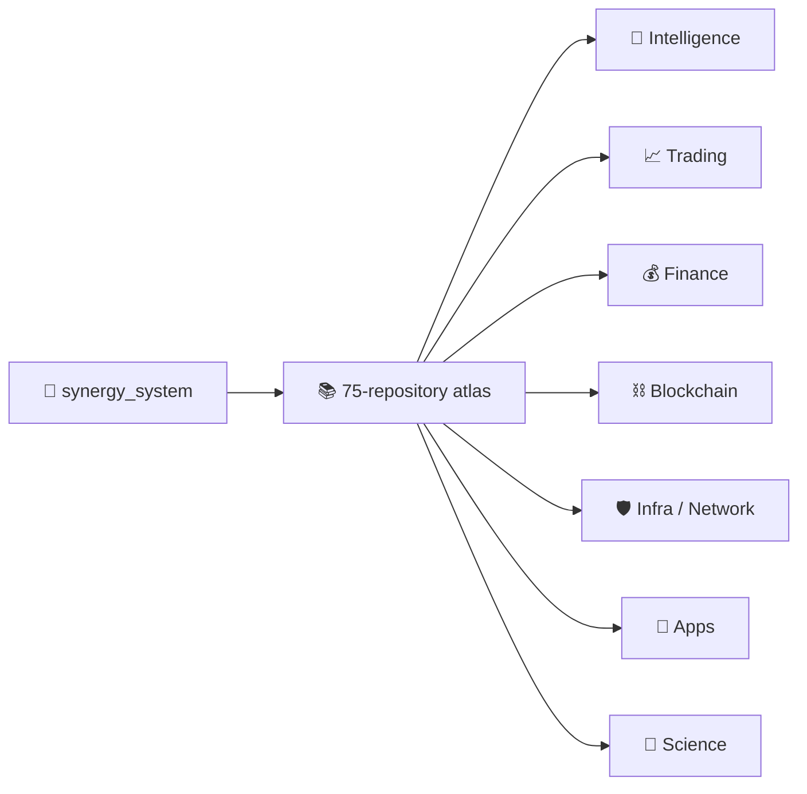

# SYNERGY SYSTEM
> ## 📚 Канонический комплект архитектуры — 29.09.2026
>
> - [🌐 Master Architecture V4](docs/MASTER_ARCHITECTURE_V4.md)
> - [🧠 System Semantic Model V1](docs/SYNERGY_SYSTEM_SEMANTIC_MODEL_V1.md)
> - [⚙️ Executable Topology V1](docs/EXECUTABLE_TOPOLOGY_V1.md)
> - [🔗 Integration Status V1](docs/INTEGRATION_STATUS_V1.md)
> - [✅ M2 Contract Endpoint Closure](docs/M2_CONTRACT_ENDPOINT_CLOSURE.md)
> - [🧪 M3 Federation E2E Gate](integration/m3_federation/README.md)
> - [🚀 M4 Wave 1 — Market Advisory Federation](integration/m4_market_advisory/README.md)
> - [🧭 Атлас 75 репозиториев](docs/SYNERGY_REPOSITORY_ATLAS.md)
> - [🧾 Repository Registry](registry/SYNERGY_REPOSITORIES.json)
> - [🏛️ Authority Registry](registry/AUTHORITY_REGISTRY.json)
> - [📜 Contract Registry](registry/CONTRACT_REGISTRY.json)
> - [🕸️ Dependency Graph](registry/DEPENDENCY_GRAPH.json)
> - [🔌 Repository Interfaces — 75/75](registry/REPOSITORY_INTERFACES.json)
> - [🧩 Integration Gaps](registry/INTEGRATION_GAPS.json)
> - [🛡️ Invariant Registry](registry/INVARIANT_REGISTRY.json)
> - [⚙️ Federation V2](config/repository_federation_v2.yaml)
> - [📘 README Standard](docs/README_STANDARD.md)
> - [✅ README Deep Pass 75/75](docs/README_DEEPENING_PLAN_75.md)
> - [🔐 Security Hygiene Findings](docs/SECURITY_HYGIENE_FINDINGS.md)
>
> `repository_federation_v1.yaml` и старые 45/46-repo документы сохраняются только как исторический provenance.
>
> **Documentation deep pass:** **75/75 COMPLETE**.
> **M2 frozen baseline:** **17/17 contract families endpoint-complete · 22 runtime edges · 20 integrated repos**.  
> **Current M4 frontier:** **22/22 contract families endpoint-complete · 27 runtime edges ADAPTER_IMPLEMENTED · 25 repos ADAPTER_INTEGRATED · 50 ARCHITECTURAL_ONLY · 0 E2E_TESTED · 0 DEPLOYED**.
> **Rule:** ни один edge не повышается до `E2E_TESTED` без фактического cross-repo evidence.


**Architecture & Governance Root for the complete SYNERGY ecosystem**

> **Repository role:** system map, architectural constitution, repository federation, authority boundaries and integration contracts.  
> **This repository is NOT:** the accounting ledger, payment executor, blockchain state machine, AI model runtime, trading engine or operating-system kernel.

---

## 0. Status and architectural rule

SYNERGY is developed as a **federation of specialized repositories**, not as one destructive monorepo.

The governing rules are:

1. **Old generations are preserved.** New architecture is added side-by-side; legacy research is not deleted merely because a newer generation exists.
2. **One authority per fact.** Accounting, settlement, trust, model inference, network routing and OS execution must not silently duplicate one another.
3. **Internal movement is not external wealth.** Mint, burn, LP marks, own-token appreciation, internal transfers and flash-loan principal are not recognized as external profit.
4. **Evidence precedes authority.** Payment evidence precedes revenue recognition; recognition precedes accounting; accounting precedes NAV; capacity precedes authorization; authorization precedes execution.
5. **AI proposes; deterministic policy constrains.** AI does not gain monetary, accounting, payment or governance authority merely by producing a recommendation.
6. **Blockchain proves; it does not invent economic truth.** Trust commitments bind exact bytes that were already produced by their authoritative domain.
7. **The portal displays; it does not become a second ledger.** UI/control-plane code consumes signed or content-addressed state.
8. **Claims are tiered.** `CANONICAL`, `CANDIDATE`, `R&D`, `LEGACY`, `ARCHIVE`, and `PRESENTATION` must remain distinguishable.
9. **No performance claim without evidence.** Network speed, compression ratio, trading return, scientific prediction and model benchmark claims require reproducible artifacts and matched baselines.
10. **No new repository without a genuinely new responsibility.** A new repo must have a clean authority boundary that cannot be represented by an existing domain owner.

---

# 1. What SYNERGY is

SYNERGY is a proposed **digital financial-economic operating system** that connects:

```text
household finance
    → savings and maturity transformation
    → mutual / productive credit
    → capital allocation
    → productive real economy
    → payments and settlement
    → revenue recognition
    → double-entry accounting
    → NAV / solvency / liquidity
    → safe reinvestment or distribution
    → cryptographic audit and trust
```

Around this economic spine are:

```text
NEXUS / OLGA / scientific agents     intelligence and reasoning
MIDAS                                 bounded trading / return sleeve
SYNERGY AI Blockchain                 trust, commitments and blockchain state
SynergyNet                            P2P mesh transport and content network
TURBO Linux                           capability-oriented host / kernel work
SYNERGY Meta-OS                       runtime orchestration of a complete node
SINERGYCHAIN / Super App              human and business control planes
AI Language / AI Coder                semantic engineering governance
AI Compress                           compression + immutable archival substrate
```

The central loop is:

```text
Savings
    ↓
Productive Capital
    ↓
Real Economy
    ↓
External Revenue
    ↓
Verified Settlement
    ↓
Double-Entry Accounting
    ↓
HardNAV / Liquidity / Risk
    ↓
Safe Reinvestment or Distribution
    ↓
More Productive Capital
```

AI, blockchain, compression, networking and automation **accelerate and protect this loop; they do not create external value by definition**.

---

# 2. The non-negotiable accounting law

The economic constitution starts from:

```text
mint                       != profit
burn                       != profit
own-token price increase   != external profit
LP / internal AMM mark     != realized external profit
flash-loan principal       != revenue
internal transfer          != consolidated income
new investor capital       != operating profit
payment receipt            != revenue
revenue                    != distributable profit
capacity                   != authorization
authorization              != settlement
settlement                 != accounting
accounting                 != trust commitment
```

External economic value must come from an external source such as:

- sale of goods or services;
- productive-project cash flow;
- external investment income;
- realized trading P&L;
- repayment of an enforceable external claim;
- externally realized asset value.

---

# 3. System-of-systems architecture

```text
┌──────────────────────────────────────────────────────────────────────────────┐
│                         SYNERGY SYSTEM                                       │
│               Architecture & Governance Federation                          │
└──────────────────────────────────────────────────────────────────────────────┘
                                      │
          ┌───────────────────────────┼───────────────────────────┐
          │                           │                           │
          ▼                           ▼                           ▼
┌──────────────────┐        ┌─────────────────────┐      ┌─────────────────────┐
│ Intelligence      │        │ Economic / Finance  │      │ Engineering / Trust │
│                   │        │                     │      │                     │
│ agi_nexus         │        │ synergy_financial_os│      │ ai_language         │
│ agi_olga          │        │ synergy_pay_system │      │ ai_coder            │
│ nexus_science_agent│       │ synergy_matrix_sota│      │ ai_compress          │
│ midas_ai          │        │ synergy_eurasian   │      │ synergy_ai_blockchain│
└─────────┬────────┘        └──────────┬──────────┘      └──────────┬──────────┘
          │                            │                             │
          └──────────────────────┬─────┴───────────────┬─────────────┘
                                 │                     │
                                 ▼                     ▼
                    ┌─────────────────────┐   ┌──────────────────────┐
                    │ SYNERGY Meta-OS     │   │ SynergyNet           │
                    │ node orchestration  │   │ P2P mesh / transport │
                    └──────────┬──────────┘   └──────────┬───────────┘
                               │                         │
                               └────────────┬────────────┘
                                            ▼
                                  ┌──────────────────┐
                                  │ TURBO Linux      │
                                  │ host / kernel    │
                                  └────────┬─────────┘
                                           │
                                           ▼
                         ┌────────────────────────────────┐
                         │ Physical / Virtual SYNERGY Node│
                         └────────────────────────────────┘
```

Application/control surfaces sit above this stack:

```text
sinergy-super-app
synergychain
synergychain.github.io
shtencoauantai.github.io
shtenco.github.io
```

They are consumers/presentation surfaces, not accounting authorities.

---

# 4. Layer model

## L0 — Host / kernel / hardware isolation

**Owner:** `Shtenco/synergy_turbo_linux`

Target responsibilities:

- capability-oriented kernel primitives;
- bounded IPC and scheduling;
- isolation of financial, AI, networking and device services;
- secure boot / TPM / sealed-key direction;
- VM support for Linux / Windows compatibility domains;
- eventual device, GPU, input and storage service planes.

`turbo_linux` is the **host substrate**, not the architecture registry and not the financial system.

---

## L1 — P2P network and content transport

**Canonical target repo:** `Shtenco/synergy_net`

SynergyNet is the planned P2P overlay in which a SYNERGY node may act as:

```text
client
+ server
+ router
+ content cache
+ blockchain peer
+ optional financial node
+ optional NEXUS/Autopilot compute node
```

Target transport pipeline:

```text
application object / packet
        ↓
content-defined chunking
        ↓
content hash / object identity
        ↓
local + network deduplication
        ↓
compression profile selection
        ↓
post-quantum authenticated encryption / session security
        ↓
multipath routing / relay / store-and-forward
        ↓
remote cache / reconstruction
        ↓
integrity verification
```

Compression should reuse validated engines from `ai_compress` where appropriate.

Important: **“faster than the Internet” is a target hypothesis, not a current fact.** SynergyNet performance claims must be measured against matched TCP/QUIC/CDN/P2P baselines with raw latency, throughput, CPU, memory and compression measurements.

SynergyNet must not automatically grant financial or blockchain authority to every relay node.

---

## L2 — Trust / blockchain

**Owner:** `Shtenco/synergy_ai_blockchain`

Responsibilities:

- post-quantum blockchain research and implementation;
- typed content commitments;
- domain separation;
- exact-byte provenance;
- state anchoring;
- verifiable execution/state evidence;
- eventual PQ-compatible EVM / smart-contract execution where proven safe;
- bridge/trust interfaces.

Core rule:

```text
Financial OS computes financial truth.
MetaPay computes settlement truth.
Blockchain commits their exact artifacts.
```

Blockchain does **not** recompute HardNAV or silently promote a `REVIEWABLE` project to `APPROVED`.

---

## L3 — Payments and settlement

**Owner:** `Shtenco/synergy_pay_system`

MetaPay / SYNERGIA Pay responsibilities:

- fiat ↔ crypto ↔ CBDC abstraction;
- omnichain route graph;
- CEX / DEX / bridge adapters;
- compliance and jurisdiction gates;
- provider capability/readiness registry;
- idempotent payment intents;
- settlement state machine;
- reconciliation;
- exact settlement receipts;
- guarded live execution only after evidence/readiness gates.

Canonical boundary:

```text
PaymentIntent
→ Compliance
→ Route / Quote
→ Liquidity / Readiness
→ Execution
→ Settlement
→ Reconciliation
→ SettlementReceipt
```

MetaPay answers **what actually settled**, not **what counts as revenue or profit**.

---

## L4 — Canonical financial accounting and solvency

**Owner:** `Shtenco/synergy_financial_os`

This is the canonical financial authority of the federation.

Responsibilities include:

- reporting-currency double-entry ledger;
- immutable ReportingEntry / LedgerEvent generations;
- account registry;
- valuation policy;
- HardNAV / LiquidNAV / EconomicNAV;
- maturity and liquidity evidence;
- LCR;
- revenue recognition;
- project screening;
- capital authorization;
- period close / accounting close;
- Merkle inclusion proofs;
- restatement and prior-period correction;
- deterministic historical replay;
- distribution capacity;
- distribution accounting;
- payout reversal accounting;
- remaining-profit budget state;
- current-capacity recalculation;
- capacity reservation / commitment state;
- bounded AI policy interfaces.

Fundamental state:

```text
HardNAV = Hard External Assets - External Liabilities
```

The repository is deliberately append-only by generation: old schemas remain provenance even after newer versions supersede them.

**Important status note:** active canonical-candidate work may exist in stacked feature branches / draft PRs while `main` still has a minimal README. Presence on `main` is not itself evidence of production readiness.

---

## L5 — Household capital, maturity and mutual credit

**Owner:** `Shtenco/synergy_matrix_sota`

The historical “matrix” lineage is reinterpreted as:

```text
household income
- household expenses
= financial delta
        ↓
independent savings tranches
        ↓
maturity ladder
        ↓
liquidity-safe mutual/P2P credit
        ↓
principal repayment
        ↓
capital reuse
```

Rules:

- a new contribution is a new tranche, not a new participant;
- current contribution must not fund the same participant’s current loan;
- loan maturity must fit funding maturity;
- callable money is not treated as long-term funding;
- currencies are never nominally summed without an explicit translation policy;
- repaid principal may be reused sequentially, not multiplied into simultaneous money.

---

## L6 — Productive real economy and capital allocation

**Owner:** `Shtenco/synergy_eurasian`

Responsibilities / target architecture:

- project proposals;
- physical/resource constraints;
- multi-currency CAPEX and cash flows;
- input-output / Leontief modelling;
- capacity bottlenecks;
- energy / logistics / materials / labour constraints;
- evidence bundles for observed projects;
- EAEU / Eurasian productive-capital scenarios;
- productive escrow / milestone evidence.

The repo answers:

> **What should or can be built, with what resources, constraints and cash flows?**

It does not approve capital by itself. Financial approval remains in Financial OS / human governance.

---

# 5. Intelligence architecture

## 5.1 `agi_nexus` — canonical NEXUS core

**New canonical target. Current repository state: bootstrap/minimal.**

`agi_nexus` should become the single canonical home of the best validated NEXUS generations.

Target responsibilities:

- graph-transformer / small-world reasoning core;
- cybernetic controller;
- formal/logical core;
- world models;
- episodic and semantic memory interfaces;
- sparse information-field / graph routing;
- model training and inference runtime;
- benchmark registry;
- frozen evaluation splits;
- deterministic model/artifact identity;
- multi-agent / collective reasoning primitives.

Migration rule:

```text
agi_olga / historical NEXUS branches
        ↓
independent benchmark + reproduction
        ↓
only validated component
        ↓
agi_nexus canonical generation
```

Never delete the original source generation after migration.

---

## 5.2 `agi_olga` — research lineage and OLGA integration

Current role:

- SmallWorld AGI;
- ARC object algebra / DSL;
- NEXUS-600K and historical NEXUS generations;
- OLGA conversational/agent integration;
- graph reasoning experiments;
- source provenance for the canonical NEXUS migration.

`agi_olga` remains a valuable research repository; it should not be rewritten into `agi_nexus` or deleted.

---

## 5.3 `nexus_science_agent` — scientific research agent

**New canonical target. Current repository state: bootstrap/minimal.**

The scientific agent should use validated NEXUS cores but have a different authority and workflow from `agi_nexus`.

Target architecture:

```text
research question
        ↓
query decomposition
        ↓
web / paper / dataset / repository search
        ↓
local search-engine index + content-addressed cache
        ↓
claim extraction
        ↓
evidence graph
        ↓
source quality / date / provenance scoring
        ↓
contradiction and falsification search
        ↓
hypothesis graph
        ↓
calculation / code / experiment generation
        ↓
independent verification attempts
        ↓
reproducible research package
        ↓
report with citations + uncertainty + open questions
```

It should integrate naturally with scientific repositories such as:

- `info_graph_theory`;
- `cold_nuclear`;
- future chemistry/materials/energy/biology research domains.

Scientific rule:

```text
model conclusion != scientific truth
search result      != evidence
simulation         != experiment
internal closure   != external confirmation
```

Every important claim should be linked to source evidence, computation or experimental status.

---

# 6. MIDAS architecture

## 6.1 `midas_ai` — canonical MIDAS domain

**New canonical target. Current repository state: bootstrap/minimal.**

MIDAS should be treated as a **bounded investment/trading intelligence sleeve**, not as the central bank and not as the source of accounting truth.

Target structure:

```text
Market / Alternative Data
        ↓
Feature & Graph Layer
        ↓
Strategy Experts
        ↓
Meta Models / Regime Models
        ↓
Portfolio / Pyramiding / Position Logic
        ↓
Independent Risk Engine with veto
        ↓
Decision Artifact
        ↓
Execution Adapter
        ↓
Broker / Venue
        ↓
Reconciled external P&L
        ↓
Financial OS
```

Only realized/reconciled external trading results may be recognized by Financial OS.

## 6.2 MIDAS source / legacy family

The following repos should be treated as source R&D or legacy components feeding `midas_ai` only after independent revalidation:

- `midas_ai_trading_system` — multi-agent institutional trading architecture;
- `midas_lite` — lightweight lineage;
- `ai_trade_terminal` — Cassandra supervisor/trading terminal lineage;
- `algotrading_graph_system` — graph-trading placeholder / future R&D source;
- `3D_bars_market_structure` — volume/time/price representation research;
- `computer_vision_trading_metatrader_5` — visual/CNN market representation;
- `cross_forex_arbitrage_trading_metatrader_5` — synthetic cross-rate / graph arbitrage;
- `swap_arbitrage_metatrader_5` — carry/swap portfolio research;
- `global_liquidity_dataminer` — central-bank/global-liquidity features;
- `multi_threaded_trading_robot_with_machine_learning_python` — parallel ML trading lineage;
- `quantum-trading_metatrader5` — historical quantum-trading experiment.

Historic README performance figures are **not automatically canonical MIDAS evidence**. Migration requires causal data discipline, no-lookahead controls, OOF/walk-forward tests, costs/slippage and a reproducible benchmark artifact.

---

# 7. `synergy_meta_os` — runtime operating system of a complete node

**New canonical target. Current repository state: bootstrap/minimal.**

Do not confuse `synergy_system` and `synergy_meta_os`:

```text
synergy_system   = static architecture / governance / repository federation
synergy_meta_os  = running orchestrator of an actual SYNERGY node
```

Target node composition:

```text
SYNERGY Meta-OS
│
├── host attestation / node identity
├── service manifest and capability graph
├── SynergyNet daemon
├── blockchain peer / validator role if authorized
├── Financial OS services if authorized
├── MetaPay services if authorized
├── NEXUS / agent runtime
├── Autopilot / business services
├── compression/content cache
├── update / rollback manager
├── observability / audit
└── resource scheduler
        ↓
TURBO Linux / compatible host
```

The Meta-OS must orchestrate authorities; it must not collapse them into one privileged process.

---

# 8. Full financial causal machine

The current target causal chain is:

```text
REAL EXTERNAL VALUE
        ↓
SETTLEMENT EVIDENCE
        ↓
ECONOMIC CLASSIFICATION
        ↓
REVENUE RECOGNITION
        ↓
DOUBLE ENTRY
        ↓
LEDGER EVENT
        ↓
MERKLE ACCOUNTING CLOSE
        ↓
FINANCIAL SNAPSHOT
        ↓
PERIOD CLOSE / RESTATEMENT / REPLAY
        ↓
LIQUIDITY REPLAY
        ↓
DISTRIBUTION CAPACITY
        ↓
REMAINING-PROFIT BUDGET
        ↓
CURRENT AVAILABLE CAPACITY
        ↓
CAPACITY RESERVATION / COMMITMENT STATE
        ↓
HUMAN / MULTISIG AUTHORIZATION
        ↓
METAPAY EXECUTION
        ↓
ACTUAL SETTLEMENT ACCOUNTING
        ↓
NEW CLOSED FINANCIAL STATE
        ↓
CAUSAL TRACE
        ↓
EXTERNAL TRUST COMMITMENT
        ↓
READ-ONLY CONTROL PLANE
```

The sequence deliberately distinguishes **measurement**, **authority**, **execution**, **accounting**, and **proof**.

---

# 9. Distribution safety architecture

A positive profit number is not enough to pay money.

```text
realized P&L
        ↓
retention / losses
        ↓
profit budget
        ↓
HardNAV solvency headroom
        ↓
1w / 4w / 8w post-distribution liquidity headroom
        ↓
current distribution capacity
        ↓
subtract already canonically distributed period profit
        ↓
remaining current capacity
        ↓
subtract outstanding reservations
        ↓
remaining authorizable capacity
        ↓
human / multisig approval
        ↓
MetaPay
```

This protects against two different replay classes:

1. **Sequential replay:** the same earned period profit is distributed again under a new authorization.
2. **Parallel race:** two independent plans reserve the same current capacity before either payout reaches the ledger.

The reservation/commitment layer is commitment-only; it is not a hidden accounting ledger.

---

# 10. Engineering and semantic governance

## `ai_language`

Authority:

- requirement identities;
- semantic traceability;
- repository/change/impact graphs;
- requirement coverage;
- requirement-registry binding.

It answers:

> Which requirement caused this change and what evidence verifies it?

## `ai_coder`

Authority:

- engineering change-set orchestration;
- evidence gates;
- code/test/review workflow.

Maximum automatic conclusion should remain `REVIEWABLE`, not automatic production deployment of financial code.

## `ai_compress`

Authority:

- compression algorithms;
- deduplication research;
- archive manifests;
- content-addressed historical snapshots;
- compression benchmarking.

It is also the natural compression technology source for SynergyNet, but networking benchmarks must measure total system cost, not only archive size.

---

# 11. Scientific research federation

## `info_graph_theory`

Independent mathematical/computational candidate theory repository. Internal closure and experimental confirmation must remain explicitly different statuses.

## `cold_nuclear`

Computational research programme. Simulations, stress tests and hypotheses must never be relabelled as experimental proof.

## `nexus_science_agent`

Cross-domain research orchestrator that can search, index, reason, falsify, calculate and package evidence, but does not replace domain-specific scientific validation.

Recommended future relationship:

```text
nexus_science_agent
        ↓
research protocol + evidence graph
        ↓
info_graph_theory / cold_nuclear / future domain repo
        ↓
reproducible computation / experiment
        ↓
scientific status artifact
```

---

# 12. Legacy financial / tokenomic research

## `ai_financial_system`

Role: **Financial R&D and falsification laboratory**.

Preserve:

- AI Central Bank experiments;
- AMM / QE / QT;
- bridge economics;
- flash-loan experiments;
- MEV/order-flow studies;
- graph-market experiments;
- negative controls;
- previous Financial OS generations.

Results can feed `synergy_financial_os` only through explicit evidence/handoff contracts.

## `usds`

Role: stable-money / mint-sell-restore-price monetary experiment.

Its own documentation correctly separates an externally assumed productive `value_added` from mint/CPMM mechanics. This distinction must remain permanent.

## `cashero`

Role: historical cyclic-liquidity/tokenomics lineage and live-robot provenance.

Never use Cashero’s old live/private-key conventions as a security template for the modern system.

---

# 13. Application and presentation surfaces

## `synergychain`

Private source for SINERGYCHAIN / Growth OS / business control plane:

- OLGA chat;
- multi-agent workflows;
- Business Expert Autopilot;
- AI SMM / CRM / Sales / CFO;
- control-plane consumers of authoritative state.

It is not the canonical ledger.

## `synergychain.github.io`

Public static presentation deployment only.

## `sinergy-super-app`

Mobile/super-app client lineage. Target role: personal finance, wallet, portfolio, payments, project participation, governance and read-only trust verification.

## `shtencoauantai.github.io`

Quant/AI public showcase and historical public-facing surface.

## `shtenco.github.io`

Personal/research/quantitative portfolio provenance.

Presentation repositories must never become hidden production authority simply because users interact with them.

---

# 14. Complete repository federation map

The current owner repository inventory contains **37 repositories**.

| Repository | Architectural role | Current classification |
|---|---|---|
| `synergy_system` | Architecture & Governance Root | **NEW CANONICAL ROOT** |
| `synergy_meta_os` | runtime node orchestration | **NEW CANONICAL TARGET / BOOTSTRAP** |
| `synergynet` | PQ P2P mesh/content network | **NEW CANONICAL TARGET / EMPTY BOOTSTRAP** |
| `turbo_linux` | host/kernel/capability substrate | **ACTIVE OS R&D / TARGET HOST** |
| `synergy_ai_blockchain` | trust commitments / PQ blockchain | **CANONICAL TRUST TARGET + ACTIVE CANDIDATES** |
| `synergy_financial_os` | accounting/NAV/solvency authority | **CANONICAL FINANCIAL TARGET + ACTIVE CANDIDATES** |
| `synergy_pay_system` | MetaPay routing/settlement/execution | **CANONICAL SETTLEMENT DOMAIN** |
| `synergy_matrix_sota` | household savings/maturity/mutual credit | **CANONICAL DOMAIN TARGET** |
| `synergy_eurasian` | productive projects / Eurasian economic model | **CANONICAL DOMAIN TARGET** |
| `agi_nexus` | canonical NEXUS model/core | **NEW CANONICAL TARGET / BOOTSTRAP** |
| `nexus_science_agent` | web/search/evidence scientific research agent | **NEW CANONICAL TARGET / BOOTSTRAP** |
| `agi_olga` | SmallWorld/OLGA/NEXUS research lineage | **ACTIVE R&D / SOURCE PROVENANCE** |
| `midas_ai` | canonical MIDAS trading intelligence | **NEW CANONICAL TARGET / BOOTSTRAP** |
| `midas_ai_trading_system` | institutional MIDAS architecture lineage | **SOURCE / R&D** |
| `midas_lite` | lightweight MIDAS lineage | **LEGACY / SOURCE** |
| `ai_trade_terminal` | Cassandra trading/control terminal | **LEGACY / SOURCE** |
| `algotrading_graph_system` | graph-trading placeholder | **R&D PLACEHOLDER** |
| `3D_bars_market_structure` | 3D market representation research | **TRADING R&D SOURCE** |
| `computer_vision_trading_metatrader_5` | CV market representation | **TRADING R&D SOURCE** |
| `cross_forex_arbitrage_trading_metatrader_5` | cross-rate / graph arbitrage | **TRADING R&D SOURCE** |
| `swap_arbitrage_metatrader_5` | carry/swap portfolio research | **TRADING R&D SOURCE** |
| `global_liquidity_dataminer` | macro/global-liquidity features | **TRADING R&D SOURCE** |
| `multi_threaded_trading_robot_with_machine_learning_python` | parallel ML trading lineage | **TRADING R&D SOURCE** |
| `quantum-trading_metatrader5` | historical quantum trading experiment | **LEGACY R&D** |
| `ai_financial_system` | AI-CB/AMM/QE/MEV/financial research | **FINANCIAL R&D / SOURCE** |
| `usds` | stable-money monetary experiment | **MONETARY R&D** |
| `cashero` | cyclic token/liquidity lineage | **LEGACY TOKENOMIC R&D** |
| `ai_language` | semantic requirements + coding-agent traceability | **ENGINEERING CORE** |
| `ai_coder` | engineering orchestration/evidence gates | **ENGINEERING CONTROL** |
| `ai_compress` | compression / dedup / archive | **COMPRESSION & ARCHIVE CORE** |
| `info_graph_theory` | fundamental mathematical/physics candidate theory | **SCIENTIFIC R&D** |
| `cold_nuclear` | computational LENR/transmutation research | **SCIENTIFIC R&D** |
| `synergychain` | Growth OS / business / portal control plane | **APPLICATION CONTROL PLANE** |
| `synergychain.github.io` | public static portal deployment | **PRESENTATION** |
| `sinergy-super-app` | mobile/super-app client | **APPLICATION CLIENT** |
| `shtencoauantai.github.io` | public Quant/AI showcase | **PUBLIC / PROVENANCE** |
| `shtenco.github.io` | personal/research portfolio | **PUBLIC / PROVENANCE** |

---

# 15. Exclusive authority matrix

| Fact / decision | Authoritative owner | Explicitly NOT authoritative |
|---|---|---|
| architecture/repository map | `synergy_system` | all domain runtimes |
| host capabilities / kernel isolation | `turbo_linux` | portal, blockchain |
| P2P routing/content delivery | `synergynet` | Financial OS |
| node runtime orchestration | `synergy_meta_os` | architecture repo |
| NEXUS model inference/training | `agi_nexus` | Science Agent, portal |
| scientific research orchestration | `nexus_science_agent` | domain experiment itself |
| trading decisions | `midas_ai` under risk policy | Financial OS ledger |
| settlement fact | `synergy_pay_system` | MIDAS, portal |
| accounting fact | `synergy_financial_os` | MetaPay, blockchain, UI |
| revenue recognition | `synergy_financial_os` | payment receipt alone |
| HardNAV / LiquidNAV / EconomicNAV | `synergy_financial_os` | token price, blockchain |
| maturity/funding facts | `synergy_matrix_sota` producer → Financial OS consumer | portal |
| productive project facts | `synergy_eurasian` evidence → Financial OS screening | AI alone |
| capital/distribution authorization | human/multisig policy represented by Financial OS artifacts | NEXUS / MIDAS |
| trust commitment / blockchain state | `synergy_ai_blockchain` | accounting interpretation |
| semantic requirement binding | `ai_language` | AI Coder itself |
| engineering change evidence | `ai_coder` | production runtime |
| archive/compression identity | `ai_compress` | economic authority |
| human presentation | `synergychain` / Super App / public sites | any financial truth |

---

# 16. SYNERGY Node target architecture

A complete node can be visualized as:

```text
┌────────────────────────── SYNERGY NODE ──────────────────────────┐
│                                                                  │
│  Super App / Local UI / Business Autopilot                       │
│                │                                                 │
│  ┌─────────────▼───────────────────────────────────────────────┐ │
│  │ SYNERGY Meta-OS                                            │ │
│  │ service graph · updates · capabilities · observability     │ │
│  └───────┬─────────┬───────────┬───────────┬─────────────────┘ │
│          │         │           │           │                    │
│      NEXUS       MetaPay   Blockchain   Financial services*     │
│          │         │           │           │                    │
│  ┌───────┴─────────┴───────────┴───────────┴─────────────────┐ │
│  │ SynergyNet                                                │ │
│  │ PQ identity · mesh routing · cache · dedup · compression  │ │
│  └───────────────────────────┬───────────────────────────────┘ │
│                              │                                  │
│                    TURBO Linux / host                            │
└──────────────────────────────────────────────────────────────────┘

* only on nodes explicitly authorized for that financial role
```

Not every node must run every service. A consumer/client relay should not receive validator, treasury or accounting privileges merely because the binary supports those modules.

---

# 17. Canonical data and evidence discipline

Cross-repository objects should follow these rules:

1. explicit `schema` / version;
2. canonical serialization profile;
3. deterministic digest;
4. safe integer bounds for cross-language JSON;
5. decimal economics encoded canonically, not binary floats where exact identity matters;
6. explicit producer and consumer;
7. explicit authority semantics;
8. evidence digests rather than unstructured trust;
9. `supersedes` / lineage instead of destructive replacement;
10. read-only consumers independently re-verify critical economic relations.

Representative object families already developed in the Financial OS/MetaPay stack include:

```text
financial.snapshot/*
settlement.receipt/*
project.proposal/*
project.screening/*
capital.authorization/*
ledger.event/*
accounting.close/*
period close / restatement artifacts
revenue recognition artifacts
liquidity replay / distribution capacity artifacts
distribution reservation / commitment state artifacts
commitment.envelope/*
```

---

# 18. Version / evidence classes

Recommended federation status vocabulary:

```text
CANONICAL
    accepted domain contract / authority generation

CANDIDATE
    implementation and tests exist; promotion evidence incomplete

R&D
    research / exploration; may contain valid ideas but no production authority

LEGACY
    historical implementation retained for provenance

ARCHIVE
    immutable source/evidence snapshot

PRESENTATION
    public/UI representation only
```

Additionally, test status must distinguish:

```text
IMPLEMENTED
TESTS_PRESENT
RUNNER_EXECUTED
VERIFIED
PRODUCTION_READY
```

A queued or pre-check-failed GitHub Action is **not** a passing test.

---

# 19. Security constitution

- no real private key, seed phrase or production credential in Git;
- any secret ever published/shared/committed is treated as compromised;
- HSM/KMS/MPC or equivalent custody for production financial/blockchain keys;
- capabilities and least privilege at OS/service layer;
- explicit separation of networking identity, blockchain identity, payment credentials and treasury authority;
- signed manifests for production configuration;
- domain-separated hashes and signatures;
- post-quantum migration must use standard, reviewable primitives and must be benchmarked;
- blockchain or P2P “post-quantum” status must never rely only on a project label;
- live execution remains fail-closed when evidence/readiness/compliance is incomplete.

---

# 20. What `synergy_system` should contain

This repo should stay **small but authoritative as architecture documentation**.

Recommended structure:

```text
README.md                         complete human architecture map
config/
  repository_federation_v1.yaml machine-readable repo/authority map
  system_layers_v1.yaml          layers and dependencies
  schema_ownership_v1.yaml       cross-repo schema authority

docs/
  AUTHORITY_BOUNDARIES.md
  NODE_ARCHITECTURE.md
  ECONOMIC_CAUSAL_CHAIN.md
  NEXUS_ARCHITECTURE.md
  SYNERGYNET_ARCHITECTURE.md
  META_OS_ARCHITECTURE.md
  MIDAS_ARCHITECTURE.md
  SCIENCE_AGENT_ARCHITECTURE.md
  LEGACY_AND_PROVENANCE.md
```

Do **not** copy every repository source into this repo.

---

# 21. Immediate priorities

## P0 — Architecture root

- keep this README current;
- create machine-readable federation/authority maps;
- pin canonical/candidate versions explicitly;
- document dependency direction.

## P1 — Initialize the six new canonical roots correctly

### `agi_nexus`
Canonical NEXUS core + benchmark/evidence registry.

### `nexus_science_agent`
Search/index/evidence/falsification/research pipeline built on validated NEXUS.

### `midas_ai`
Canonical institutional trading architecture assembled only from revalidated source modules.

### `synergynet`
PQ mesh/content overlay prototype with measurable compression/dedup/routing benchmarks.

### `synergy_meta_os`
Node manifest/orchestrator integrating TURBO Linux, SynergyNet, AI, blockchain, finance and application services without collapsing authority boundaries.

### `synergy_system`
Architecture/governance only.

## P2 — Finish the current Financial OS → MetaPay distribution safety chain

The active architecture is converging toward:

```text
current available capacity
→ capacity reservation
→ commitment state
→ exact plan
→ human/multisig authorization
→ short-lived execution ticket
→ MetaPay attempt/utilization
→ canonical payout accounting
→ refreshed closed financial state
```

## P3 — NEXUS migration

Freeze a benchmark suite and migrate only reproduced best generations from `agi_olga` / historical branches into `agi_nexus`.

## P4 — MIDAS migration

Build one evidence registry across all legacy trading repositories and promote only strategies/features/models that survive current causal OOF/forward/cost tests.

## P5 — SynergyNet proof-of-concept

Start as an overlay, not as a claim to replace the Internet:

- local multi-node lab;
- content-addressed chunks;
- deduplication;
- `ai_compress` codecs;
- PQ session handshake;
- multipath routing;
- loss/reorder simulation;
- matched QUIC/TCP baseline;
- raw reproducible results.

## P6 — Meta-OS node bundle

Only after service interfaces stabilize, define one signed node manifest that can bring up a reproducible SYNERGY node.

---

# 22. Core design principle

The architecture should always preserve this separation:

```text
REALITY
  ↓
EVIDENCE
  ↓
DOMAIN INTERPRETATION
  ↓
ACCOUNTING / STATE
  ↓
POLICY / CAPACITY
  ↓
AUTHORIZATION
  ↓
EXECUTION
  ↓
NEW REALITY
  ↓
AUDIT / TRUST PROOF
```

No layer is allowed to skip directly from a model prediction to money movement.

---

# 23. Short definition

**SYNERGY is a federated financial-economic and computing architecture in which household capital, productive projects, payments, accounting, AI, trading, blockchain trust, operating systems and P2P networking are integrated through explicit authority boundaries and content-addressed evidence.**

The project’s long-term objective is not merely to build another token, another AI model or another application. It is to build a verifiable **economic + computational operating environment** in which:

- external value is distinguished from internal accounting motion;
- capital is allocated under explicit risk/liquidity constraints;
- AI reasoning is powerful but bounded;
- network and compute resources can be decentralized;
- every important transition can be audited;
- old scientific/engineering generations remain reproducible rather than being erased.

---

## Repository owner

SHTENCO / SYNERGY ecosystem.

**Architecture rule:** improve by adding verified generations, not by destroying provenance.

---

<!-- NEXUS-REPORTS-BENCHMARKS:START -->
## NEXUS — отчёты и бенчмарки

> Канонический реестр: [NEXUS_REPORTS_BENCHMARKS_REGISTRY.md](https://github.com/Shtenco/synergy_gllm_nexus/blob/main/NEXUS_REPORTS_BENCHMARKS_REGISTRY.md)  
> Канонический research runtime: [Shtenco/synergy_gllm_nexus](https://github.com/Shtenco/synergy_gllm_nexus)  
> Активная исследовательская ветка: [unified-v3-generalization-first](https://github.com/Shtenco/synergy_gllm_nexus/tree/unified-v3-generalization-first)  
> Последнее синхронное обновление README: **2026-09-19**

### Ключевые подтверждённые результаты

| Линия / benchmark | Результат | Что проверялось |
|---|---:|---|
| **R7-L D192 / Blind-18** | **3072/3072 = 100%**, 48/48 held-out operators | настоящий few-shot unseen-operator transfer, без Authority и без inference weight updates |
| **R7.2 / Blind-20** | historical **320/320 = 100% harness-assisted**; autonomous exact **254/320 = 79.375%** | final head in old harness used benchmark-side true intent; deployable path uses predicted intent |
| **R7.6 / Blind-23** | **56/58 = 96.55%** | post-freeze semantic/paraphrase transfer |
| **R7.10 / Blind-27** | **150/160 = 93.75%** | fresh 8-domain frozen blind |
| **R7.18 / Blind-31** | **156/200 = 78%** | broad post-freeze OOD |
| **R7.44 / Blind-62** | **3066/3200 = 95.81%** | context/state composite |
| **R7.44.1 / Blind-63** | **2400/2400 = 100%** | context contract |
| **R7.44.2 / Blind-64** | **2400/2400 = 100%** | context contract |
| **R7.44.3 / Blind-65** | **2400/2400 = 100%** | context contract; Dialogue-65 25/25 |
| **Ω-1.5R2 / Blind-4** | strict triple **50.37% / 66.63%** | role/subject/object/graph transfer |
| **Unified v2 UB1** | **904/970 = 93.1959%** | integration benchmark; exposed-development, не pristine blind |
| **Unified v2 UB2** | **2104/2140 = 98.3178%** | regression benchmark; regex baseline повторяет score, paraphrase stress ≈26.17% |
| **v3 P0.1 META-OOS C** | **99.44%** | synthetic OOS внутри одной high-level generator family |
| **HARD-OOS D** | **21.91%**, representation failure **100%** | zero-shot перенос на новый AST/rule-language basis; benchmark уже consumed |
| **v3-MoE P1** | useful Top-K recall **99.62%**, negative transfer **0.48%**, strict routing **98.80%** | learned MoE routing на mixed synthetic META-OOS |
| **NEXUS-MOE-B1** | learned **94.44%**, best single **33.33%**, naive **59.17%**, oracle **95.83%** | frozen one-shot на 7 exact-runnable historical experts; learned negative transfer **1.45%** |
| **FTX1** | **BLIND sealed / unopened** | главный one-shot end-to-end far-transfer benchmark |

### Полный набор канонических отчётов

1. [2026-09-15 — Ω-1.3 local 100K](https://github.com/Shtenco/synergy_gllm_nexus/blob/unified-v3-generalization-first/docs/results/2026-09-15-omega13-local-100k.md)
2. [2026-09-15 — Ω-1.4 local 100K](https://github.com/Shtenco/synergy_gllm_nexus/blob/unified-v3-generalization-first/docs/results/2026-09-15-omega14-local-100k.md)
3. [2026-09-16 — NEXUS cross-generation audit](https://github.com/Shtenco/synergy_gllm_nexus/blob/unified-v3-generalization-first/docs/results/2026-09-16-nexus-cross-generation-audit.md)
4. [2026-09-16 — Full 78-generation evidence ledger](https://github.com/Shtenco/synergy_gllm_nexus/blob/unified-v3-generalization-first/docs/results/2026-09-16-nexus-full-78-ledger.md)
5. [2026-09-16 — Ω-1.5R2 Blind-4 one-shot JSON](https://github.com/Shtenco/synergy_gllm_nexus/blob/unified-v3-generalization-first/docs/results/2026-09-16-omega15r2-blind4-one-shot.json)
6. [2026-09-16 — Ω-1.6 research-agent landscape](https://github.com/Shtenco/synergy_gllm_nexus/blob/unified-v3-generalization-first/docs/results/2026-09-16-omega16-research-agent-landscape.md)
7. [2026-09-16 — Unified NEXUS rebuild v1](https://github.com/Shtenco/synergy_gllm_nexus/blob/unified-v3-generalization-first/docs/results/2026-09-16-unified-nexus-rebuild-v1.md)
8. [2026-09-17 — FTX1 freeze report](https://github.com/Shtenco/synergy_gllm_nexus/blob/unified-v3-generalization-first/docs/results/2026-09-17-nexus-ftx1-freeze-report.md)
9. [2026-09-17 — Unified v3 P0 report](https://github.com/Shtenco/synergy_gllm_nexus/blob/unified-v3-generalization-first/docs/results/2026-09-17-nexus-unified-v3-p0-report.md)
10. [2026-09-17 — Unified v2 RC1 final](https://github.com/Shtenco/synergy_gllm_nexus/blob/unified-v3-generalization-first/docs/results/2026-09-17-unified-v2-rc1-final.md)
11. [2026-09-18 — Unified v3 P0.1 training report](https://github.com/Shtenco/synergy_gllm_nexus/blob/unified-v3-generalization-first/docs/results/2026-09-18-nexus-unified-v3-p01-training-report.md)
12. [2026-09-18 — HARD-OOS D frozen zero-shot report](https://github.com/Shtenco/synergy_gllm_nexus/blob/unified-v3-generalization-first/docs/results/2026-09-18-nexus-v3-hard-oos-d-zero-shot-report.md)
13. [2026-09-18 — v3-MoE P1 training report](https://github.com/Shtenco/synergy_gllm_nexus/blob/unified-v3-generalization-first/docs/results/2026-09-18-nexus-v3-moe-p1-training-report.md)
14. [2026-09-19 — Artifact-Complete audit + NEXUS-MOE-B1](https://github.com/Shtenco/synergy_gllm_nexus/blob/unified-v3-generalization-first/docs/results/2026-09-19-nexus-v3-moe-artifact-complete-b1-report.md)
15. [Unified v2 P0 report](https://github.com/Shtenco/synergy_gllm_nexus/blob/unified-v3-generalization-first/docs/results/UNIFIED_V2_P0_REPORT.md)
16. [Unified v2 P0 / UB1 summary JSON](https://github.com/Shtenco/synergy_gllm_nexus/blob/unified-v3-generalization-first/docs/results/UNIFIED_V2_P0_UB1_SUMMARY.json)

### Frozen benchmark suites и manifests

**CROSSGEN-1**
- [Freeze manifest](https://github.com/Shtenco/synergy_gllm_nexus/blob/unified-v3-generalization-first/benchmarks/crossgen1/CROSSGEN1_FREEZE_MANIFEST.json)
- [Schema](https://github.com/Shtenco/synergy_gllm_nexus/blob/unified-v3-generalization-first/benchmarks/crossgen1/schema.py)

**Ω / Unified frozen**
- [Ω-1.4 Blind-2 freeze](https://github.com/Shtenco/synergy_gllm_nexus/blob/unified-v3-generalization-first/benchmarks/frozen/OMEGA14_BLIND2_FREEZE_MANIFEST.json)
- [Ω-1.5 Blind-3 freeze](https://github.com/Shtenco/synergy_gllm_nexus/blob/unified-v3-generalization-first/benchmarks/frozen/OMEGA15_BLIND3_FREEZE_MANIFEST.json)
- [Ω-1.5R2 preblind final freeze](https://github.com/Shtenco/synergy_gllm_nexus/blob/unified-v3-generalization-first/benchmarks/frozen/OMEGA15R2_PREBLIND_FINAL_FREEZE.json)
- [Ω-1.5R2 Blind-4 freeze](https://github.com/Shtenco/synergy_gllm_nexus/blob/unified-v3-generalization-first/benchmarks/frozen/OMEGA15R2_BLIND4_FREEZE_MANIFEST.json)
- [Unified rebuild v1 freeze](https://github.com/Shtenco/synergy_gllm_nexus/blob/unified-v3-generalization-first/benchmarks/frozen/UNIFIED_REBUILD_V1_FREEZE_MANIFEST.json)
- [Unified integration benchmark freeze](https://github.com/Shtenco/synergy_gllm_nexus/blob/unified-v3-generalization-first/benchmarks/frozen/UNIFIED_REBUILD_V1_INTEGRATION_BENCH_FREEZE.json)
- [Unified preblind checkpoint freeze](https://github.com/Shtenco/synergy_gllm_nexus/blob/unified-v3-generalization-first/benchmarks/frozen/UNIFIED_REBUILD_V1_PREBLIND_CHECKPOINT_FREEZE.json)

**Unified v2 UB2**
- [UB2 README](https://github.com/Shtenco/synergy_gllm_nexus/blob/unified-v3-generalization-first/benchmarks/ub2/README.md)
- [Freeze manifest](https://github.com/Shtenco/synergy_gllm_nexus/blob/unified-v3-generalization-first/benchmarks/ub2/frozen/NEXUS_UB2_FREEZE_MANIFEST.json)
- [Preblind freeze](https://github.com/Shtenco/synergy_gllm_nexus/blob/unified-v3-generalization-first/benchmarks/ub2/frozen/UNIFIED_V2_PREBLIND_FREEZE.json)
- [Source-commit freeze](https://github.com/Shtenco/synergy_gllm_nexus/blob/unified-v3-generalization-first/benchmarks/ub2/frozen/UNIFIED_V2_PREBLIND_SOURCE_COMMIT.json)
- [Blind result](https://github.com/Shtenco/synergy_gllm_nexus/blob/unified-v3-generalization-first/benchmarks/ub2/results/UNIFIED_V2_UB2_BLIND_RESULT.json)
- [Generator](https://github.com/Shtenco/synergy_gllm_nexus/tree/unified-v3-generalization-first/benchmarks/ub2/generator)
- [Scoring](https://github.com/Shtenco/synergy_gllm_nexus/tree/unified-v3-generalization-first/benchmarks/ub2/scoring)
- [Validators](https://github.com/Shtenco/synergy_gllm_nexus/tree/unified-v3-generalization-first/benchmarks/ub2/validators)

**NEXUS-FTX1**
- [FTX1 README](https://github.com/Shtenco/synergy_gllm_nexus/blob/unified-v3-generalization-first/benchmarks/ftx1/README.md)
- [Frozen manifest](https://github.com/Shtenco/synergy_gllm_nexus/blob/unified-v3-generalization-first/benchmarks/ftx1/frozen/NEXUS_FTX1_FREEZE_MANIFEST.json)
- [Public generator](https://github.com/Shtenco/synergy_gllm_nexus/blob/unified-v3-generalization-first/benchmarks/ftx1/public_generator.py)
- [Schema](https://github.com/Shtenco/synergy_gllm_nexus/blob/unified-v3-generalization-first/benchmarks/ftx1/schema.py)
- [Scoring](https://github.com/Shtenco/synergy_gllm_nexus/blob/unified-v3-generalization-first/benchmarks/ftx1/scoring.py)
- [Validators](https://github.com/Shtenco/synergy_gllm_nexus/blob/unified-v3-generalization-first/benchmarks/ftx1/validators.py)
- [Red-team](https://github.com/Shtenco/synergy_gllm_nexus/blob/unified-v3-generalization-first/benchmarks/ftx1/redteam.py)
- **BLIND остаётся sealed/unopened.**

### Benchmark runners

- [Belief](https://github.com/Shtenco/synergy_gllm_nexus/blob/unified-v3-generalization-first/benchmarks/run_belief_benchmark.py)
- [General](https://github.com/Shtenco/synergy_gllm_nexus/blob/unified-v3-generalization-first/benchmarks/run_benchmark.py)
- [Compiler](https://github.com/Shtenco/synergy_gllm_nexus/blob/unified-v3-generalization-first/benchmarks/run_compiler_benchmark.py)
- [Consolidation](https://github.com/Shtenco/synergy_gllm_nexus/blob/unified-v3-generalization-first/benchmarks/run_consolidation_benchmark.py)
- [Continual](https://github.com/Shtenco/synergy_gllm_nexus/blob/unified-v3-generalization-first/benchmarks/run_continual_benchmark.py)
- [Forgetting](https://github.com/Shtenco/synergy_gllm_nexus/blob/unified-v3-generalization-first/benchmarks/run_forgetting_benchmark.py)
- [Graph Cortex](https://github.com/Shtenco/synergy_gllm_nexus/blob/unified-v3-generalization-first/benchmarks/run_graph_cortex_benchmark.py)
- [Research](https://github.com/Shtenco/synergy_gllm_nexus/blob/unified-v3-generalization-first/benchmarks/run_research_benchmark.py)
- [Temporal](https://github.com/Shtenco/synergy_gllm_nexus/blob/unified-v3-generalization-first/benchmarks/run_temporal_benchmark.py)
- [Unified v2 preblind UB1](https://github.com/Shtenco/synergy_gllm_nexus/blob/unified-v3-generalization-first/benchmarks/run_unified_v2_preblind_ub1.py)

### v3 артефакты

**P0.1 META-OOS**
- [Manifest](https://github.com/Shtenco/synergy_gllm_nexus/blob/unified-v3-generalization-first/artifacts/v3_meta/p01_first_hard/manifest.json)
- [Metrics](https://github.com/Shtenco/synergy_gllm_nexus/blob/unified-v3-generalization-first/artifacts/v3_meta/p01_first_hard/metrics.json)
- [Ranker](https://github.com/Shtenco/synergy_gllm_nexus/blob/unified-v3-generalization-first/artifacts/v3_meta/p01_first_hard/ranker.pt)

**HARD-OOS D**
- [Manifest](https://github.com/Shtenco/synergy_gllm_nexus/blob/unified-v3-generalization-first/artifacts/v3_hard_oos_d/manifest.json)
- [Corpus summary](https://github.com/Shtenco/synergy_gllm_nexus/blob/unified-v3-generalization-first/artifacts/v3_hard_oos_d/corpus_summary.json)
- [Topology inventory](https://github.com/Shtenco/synergy_gllm_nexus/blob/unified-v3-generalization-first/artifacts/v3_hard_oos_d/topology_inventory.json)
- [Zero-shot metrics](https://github.com/Shtenco/synergy_gllm_nexus/blob/unified-v3-generalization-first/artifacts/v3_hard_oos_d/zero_shot_metrics.json)
- [Baselines](https://github.com/Shtenco/synergy_gllm_nexus/blob/unified-v3-generalization-first/artifacts/v3_hard_oos_d/baseline_metrics.json)
- [Consumed marker](https://github.com/Shtenco/synergy_gllm_nexus/blob/unified-v3-generalization-first/artifacts/v3_hard_oos_d/consumed.json)

**v3-MoE P1**
- [Manifest](https://github.com/Shtenco/synergy_gllm_nexus/blob/unified-v3-generalization-first/artifacts/v3_moe/p1/manifest.json)
- [Metrics](https://github.com/Shtenco/synergy_gllm_nexus/blob/unified-v3-generalization-first/artifacts/v3_moe/p1/metrics.json)
- [Router](https://github.com/Shtenco/synergy_gllm_nexus/blob/unified-v3-generalization-first/artifacts/v3_moe/p1/router.pt)
- [Novelty](https://github.com/Shtenco/synergy_gllm_nexus/blob/unified-v3-generalization-first/artifacts/v3_moe/p1/novelty.pt)
- [Calibrator](https://github.com/Shtenco/synergy_gllm_nexus/blob/unified-v3-generalization-first/artifacts/v3_moe/p1/calibrator.pt)

### Научная политика

- Few-shot unseen-operator induction и zero-shot перенос на новый язык правил — разные уровни transfer.
- UB2 хранится как regression benchmark, но его 98.3178% не считается доказательством общего интеллекта.
- HARD-OOS D уже **consumed** и не может повторно считаться clean OOS после D-informed обучения.
- FTX1 BLIND остаётся закрытым до one-shot protocol.
- v3-MoE P1 пока доказывает качество **routing**, а не окончательный end-to-end прирост answer accuracy.

<!-- NEXUS-REPORTS-BENCHMARKS:END -->


---

# 🧭 Канонический атлас 75 репозиториев

Экосистема SYNERGY на текущем срезе включает **75 репозиториев**. Их архитектурные роли, домены, master-узлы и связи сведены в единый реестр:

- 📚 [SYNERGY Repository Atlas — карта всех 75 репозиториев](docs/SYNERGY_REPOSITORY_ATLAS.md)
- 🧾 [Машиночитаемый реестр](registry/SYNERGY_REPOSITORIES.json)



Важно: связи в атласе разделяют **архитектурную принадлежность** и **доказанную runtime/code dependency**. Само наличие стрелки в системной карте не означает, что один репозиторий импортирует или запускает другой.
