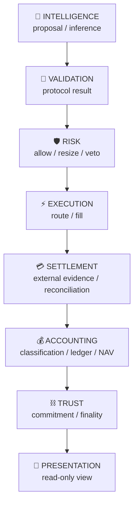
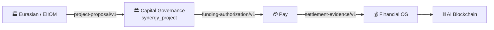
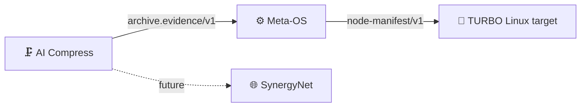
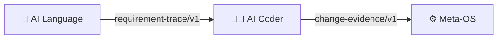
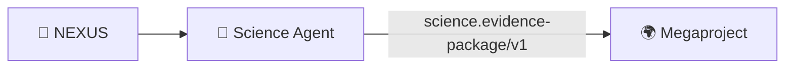

# ⚙️ SYNERGY EXECUTABLE TOPOLOGY V1

> Срез: 28 сентября 2026.
> Цель: показать не всю желаемую архитектуру, а **фактически материализованные typed boundaries** и оставшиеся разрывы.

## 1. Текущий системный срез

```text
Repositories                         75
Typed contract families             17
Runtime edges ADAPTER_IMPLEMENTED   22
Runtime edges E2E_TESTED             0
Runtime edges DEPLOYED               0

Repository interface states:
  ADAPTER_INTEGRATED                20
  PARTIAL_IMPLEMENTATION             0
  CONTRACT_DEFINED                   0
  ARCHITECTURAL_ONLY                55
```

Главное: SYNERGY уже перестала быть только документационной федерацией, но ещё не является полностью E2E-запущенной distributed OS.

---

# 2. Плоскости истины



Ни одна стрелка не означает перенос authority. Каждый слой владеет только своим типом факта.

---

# 3. Вертикаль A — AI-assisted institutional trading


### Enforcement

```text
NEXUS proposal        != authorization
MIDAS proposal        != validation pass
validation pass       != risk permission
risk permission       != fill
fill                  != settlement
settlement            != revenue
accounting recognition!= blockchain-created truth
```

`NEXUS → MIDAS` специально реализован как `authorization=false` + `requires_domain_validation=true`.

---

# 4. Вертикаль B — Real Economy / capital deployment



### Исправленный causal invariant

Старый shortcut:

```text
optimizer/project proposal → Financial OS
```

запрещён.

Новый путь:

```text
project proposal
→ explicit underwriting/governance
→ bounded authorization
→ payment execution
→ external settlement/reconciliation
→ accounting recognition
```

`ProjectProposal` не может self-authorize. `AUTHORIZE` требует approver provenance, underwriting evidence, expiry, currency, payment rails и максимальную сумму.

---

# 5. Вертикаль C — Artifact / runtime integrity



Материализовано:

- AI Compress создаёт evidence только при exact byte round-trip;
- archive SHA-256 и byte size входят в contract;
- Meta-OS сверяет evidence с реальным artifact file;
- Meta-OS уже умеет hash-check manifests, role/capability ceilings, attestation, resource limits и fail-closed dangerous capabilities.

`Meta-OS → TURBO Linux` теперь materialized как `ADAPTER_IMPLEMENTED`: TURBO consumer проверяет profile, SHA-256, resource limits и требует attestation для dangerous capabilities.

---

# 6. Engineering lineage



Текущее состояние:

- AI Language producer реально строится из `SemanticTrace`, `REQ-*`, mutation/validation events и coverage;
- AI Coder теперь consume’ит `requirement-trace/v1` и выпускает `change-evidence/v1`;
- Meta-OS принимает change evidence только при `APPROVED`, всех checks=`PASS` и requirement provenance;
- generated code по-прежнему не является deployment permission сам по себе.

---

# 7. Scientific lineage



Science Agent теперь имеет минимальное fail-closed epistemic ядро: NEXUS остаётся advisory-only, evidence package разделяет `SOURCE/MEASURED/DERIVED/SIMULATION/HYPOTHESIS/FALSIFIED/UNRESOLVED`, а Megaproject принимает пакет только в curated review queue без автоматической мутации канонического графа.

---

# 8. Trust / cross-chain / UI lineage

```mermaid
flowchart LR
    F[💰 Financial OS] --> B[⛓️ AI Blockchain]
    B -. trust.commitment/v1 .-> MC[🌉 MetaChain]
    B -. trust.commitment/v1 .-> A[📱 Apps]
```

Financial OS → Blockchain уже materialized через authority-preserving domain commitment.

MetaChain теперь consume’ит только `FINALIZED` trust commitments и блокирует replay; Apps consume’ят accounting/trust только как read-only projections без переноса authority.

---

# 9. Machine-readable control plane

Канонические файлы:

```text
registry/SYNERGY_REPOSITORIES.json
registry/AUTHORITY_REGISTRY.json
registry/CONTRACT_REGISTRY.json
registry/DEPENDENCY_GRAPH.json
registry/REPOSITORY_INTERFACES.json
registry/INTEGRATION_GAPS.json
registry/INVARIANT_REGISTRY.json
```

Их назначение:

| Registry | Ответ на вопрос |
|---|---|
| Repository Registry | какие 75 репозиториев входят в систему? |
| Authority Registry | кто владеет каким типом истины? |
| Contract Registry | какие typed artifacts существуют? |
| Dependency Graph | какие связи архитектурные, contract или runtime? |
| Repository Interfaces | что каждый repo производит/потребляет? |
| Integration Gaps | какой endpoint отсутствует для следующего promotion? |
| Invariant Registry | какие shortcuts система обязана запрещать? |

---

# 10. Contract representations

Для V1 используются три representations:

```text
JSON Schema 2020-12  → canonical language-neutral validation
Pydantic V2          → Python reference implementation
Protobuf             → RPC / binary wire representation
```

Breaking semantic change требует нового major contract ID (`.../v2`).

---

# 11. Evidence and trace

Канонический Evidence ID:

```text
urn:synergy:evidence:<repo>:<kind>:sha256:<digest>
```

Один `trace_id` должен проходить через целый causal process. Evidence ID доказывает identity байтов/артефакта, но не автоматически истинность claim.

---

# 12. Что блокирует E2E_TESTED

Cross-repo promotion gates теперь существуют для двух уровней:

```text
integration/trading_truth_path/
integration/m3_federation/
```

но promotion не выполнен, потому что GitHub Actions текущего private repo создаёт jobs, завершающиеся без выполненных steps; job logs недоступны. Поэтому CI намеренно не помечен GREEN.

Следующий promotion допускается только после фактического запуска pinned checkout набора и evidence bundle.

---

# 13. Следующий рубеж

`INTEGRATION_GAPS.json` теперь показывает `17/17` контрактов без missing endpoints. Следующая цель — не новые adapters, а **M3 cross-repo E2E evidence** для всех 22 runtime edges, после чего подтверждённые связи можно повысить с `ADAPTER_IMPLEMENTED` до `E2E_TESTED`.

---

# 14. Архитектурный критерий зрелости

SYNERGY становится операционной системой не тогда, когда все 75 repos имеют стрелки, а когда для каждой важной стрелки можно ответить:

```text
What contract_id?
What schema_version?
Who is producer?
Who is canonical authority?
Who is consumer?
What exact bytes were transferred?
What evidence_id proves the transition?
What trace_id connects it to reality?
What status is proven: DEFINED / ADAPTER / E2E / DEPLOYED?
```

Именно этот принцип теперь является основой дальнейшей интеграции федерации.
