# 🔗 SYNERGY Integration Status V1

> Срез: 28 сентября 2026.
> Этот документ отвечает только на вопрос **что реально связано кодом**, а не что нарисовано в архитектуре.

## Текущий итог

```text
Repositories                        75
Typed contract families            16
Runtime edges ADAPTER_IMPLEMENTED   6
Runtime edges E2E_TESTED            0
Runtime edges DEPLOYED              0
```

## Первая материализованная вертикаль

```mermaid
flowchart LR
    M[📈 MIDAS] -->|portfolio-decision/v1| Q[🧪 QuantLab]
    Q -->|validation-decision/v1| R[🛡️ RiskGuard]
    R -->|risk-decision/v1| X[🔀 TradeMux]
    X -->|execution-result/v1| P[💳 Pay]
    P -->|settlement-evidence/v1| F[💰 Financial OS]
    F -->|accounting-recognition/v1| B[⛓️ AI Blockchain]
```



### Что уже реализовано

| Edge | Status | Реальная enforcement-логика |
|---|---|---|
| MIDAS → QuantLab | `ADAPTER_IMPLEMENTED` | QuantLab валидирует bounded portfolio candidate |
| QuantLab → RiskGuard | `ADAPTER_IMPLEMENTED` | только `PAPER/CANARY` может стать order intent |
| RiskGuard → TradeMux | `ADAPTER_IMPLEMENTED` | `REJECT/KILL_SWITCH` fail closed; `RESIZE` ограничивает notional |
| TradeMux → Pay | `ADAPTER_IMPLEMENTED` | fill превращается только в expected internal settlement evidence |
| Pay → Financial OS | `ADAPTER_IMPLEMENTED` | только reconciled `SETTLED` допускается к recognition |
| Financial OS → AI Blockchain | `ADAPTER_IMPLEMENTED` | blockchain commits authoritative bytes; бухгалтерский смысл не переопределяется |

## Что намеренно НЕ считается связанным

- `execution-plan/v1` — внутренний контракт TradeMux, не межрепозиторный edge;
- TradeMux → Financial OS — запрещённый shortcut; accounting идёт только через Pay settlement evidence;
- AI recommendation → execution — прямого edge нет;
- blockchain commitment → accounting — направление authority обратное не допускается.

## Статусы интеграции

```text
DOCUMENTED
→ CONTRACT_DEFINED
→ PRODUCER_IMPLEMENTED
→ CONSUMER_IMPLEMENTED
→ ADAPTER_IMPLEMENTED
→ E2E_TESTED
→ DEPLOYED
```

`ADAPTER_IMPLEMENTED` означает: обе стороны имеют executable adapter/enforcement code.
Это **не** означает, что семь независимых репозиториев уже были запущены одним end-to-end тестом.

## Cross-repo promotion gate

Создан:

```text
integration/trading_truth_path/
  integration_lock_v1.json
  run.py
  README.md
```

и ручной workflow `.github/workflows/trading-truth-path-e2e.yml`.

После успешного запуска pinned cross-repo harness соответствующие 6 runtime edges можно повысить до `E2E_TESTED`.

## CI status

Первый automatic `Validate SYNERGY Typed Contracts` run был создан GitHub Actions, но job завершился без выполненных steps (`steps: []`), а download job log вернул `BlobNotFound`. Поэтому этот run **не помечен GREEN** и не используется как доказательство прохождения tests.

Старый federation-validator ранее также завершился без steps. До успешного фактического runner execution статус CI остаётся `UNRESOLVED_RUNNER_EXECUTION`.

## Следующие вертикали

1. `NEXUS → domain proposal → deterministic validator`;
2. `Science Agent → Megaproject evidence graph`;
3. `Eurasian → governance → Pay → Financial OS`;
4. `AI Language → AI Coder → Meta-OS deployment evidence`;
5. `AI Compress → SynergyNet → Meta-OS`;
6. `Meta-OS → TURBO Linux capability manifest`;
7. `Financial OS → Blockchain → MetaChain → Apps` read-only trust path.
