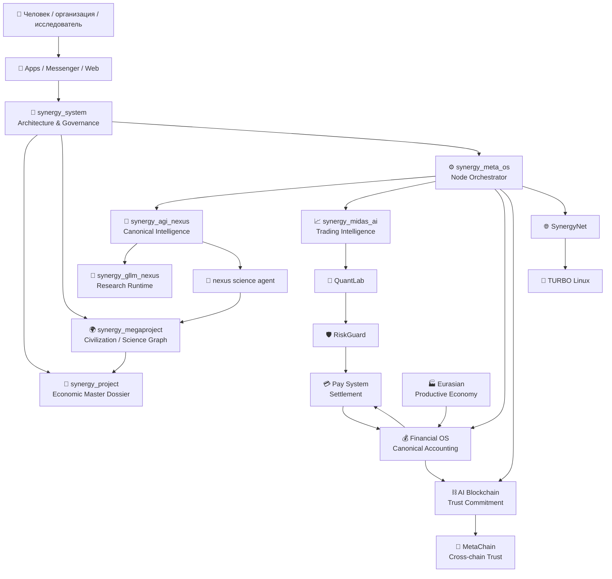
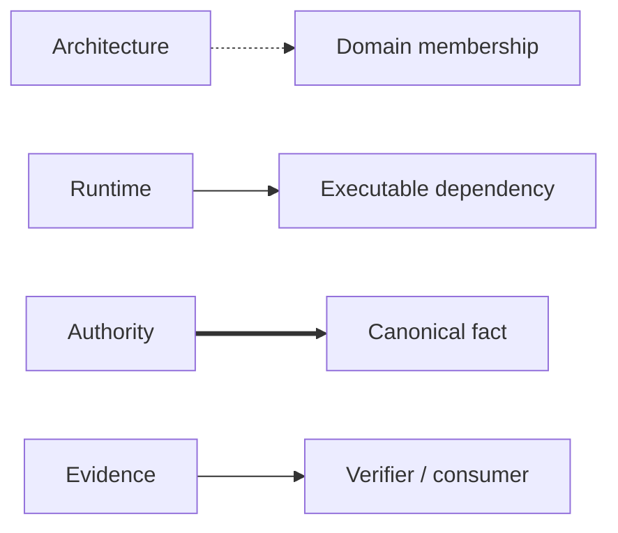
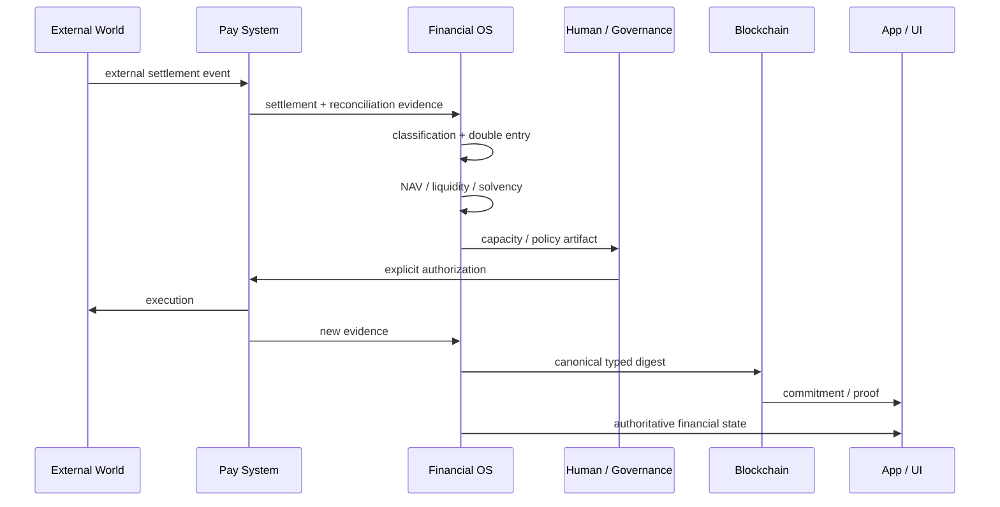
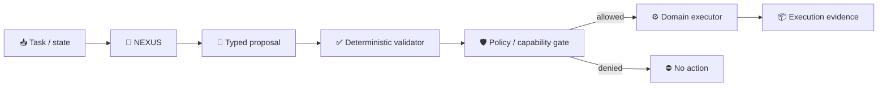
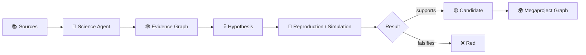
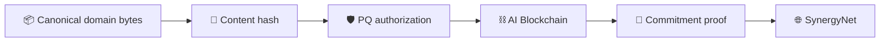
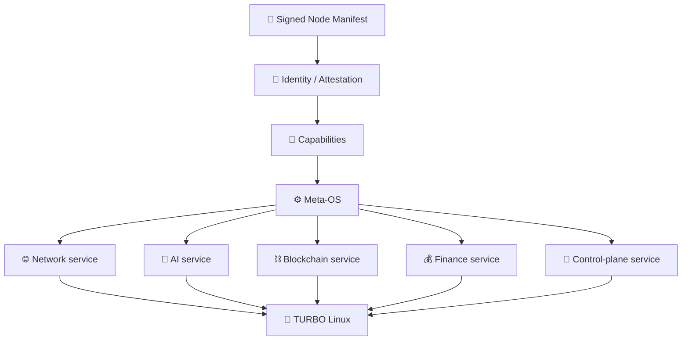
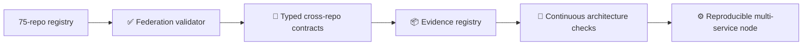

# 🌐 SYNERGY MASTER ARCHITECTURE V4

> **Каноническая архитектура федерации из 75 репозиториев.**  
> Срез: **28 сентября 2026**.  
> Architecture root: [`Shtenco/synergy_system`](https://github.com/Shtenco/synergy_system)

---

# 1. Что именно является SYNERGY

SYNERGY — это не монорепозиторий и не одна программа. Это **федерация независимых authority-доменов**, соединённых типизированными контрактами.

Главный принцип:

```text
one fact
  ↓
one canonical authority
  ↓
many verifiable consumers
```

Ни AI, ни blockchain, ни UI, ни root-процесс не получают право подменять domain authority только потому, что технически способны прочитать или изменить данные.

---

# 2. Архитектура верхнего уровня



---

# 3. Четыре разных типа связи

Одна из главных ошибок больших систем — рисовать одну стрелку и считать, что она означает всё сразу. В SYNERGY связи разделяются.

| Тип связи | Что означает |
|---|---|
| `ARCHITECTURAL_PARENT` | логическая принадлежность к домену |
| `RUNTIME_DEPENDENCY` | один runtime реально импортирует/вызывает другой |
| `AUTHORITY_FLOW` | один домен является источником канонического факта |
| `EVIDENCE_FLOW` | передаётся доказательство/receipt/hash/report без переноса authority |



**Правило:** наличие `ARCHITECTURAL_PARENT` никогда само по себе не доказывает `RUNTIME_DEPENDENCY`.

---

# 4. Канонический поток экономической истины



Ключевые отрицательные равенства:

```text
payment receipt          != revenue
revenue                  != distributable profit
mint                     != profit
internal AMM mark        != HardNAV
blockchain hash          != accounting interpretation
AI recommendation        != authorization
service running          != permission
UI balance               != ledger
```

---

# 5. Канонический поток AI



NEXUS может формировать:

- inference;
- hypothesis;
- plan;
- recommendation;
- structured proposal;
- risk assessment.

Но по умолчанию не получает:

- treasury authority;
- payment authority;
- ledger mutation authority;
- consensus authority;
- production deployment authority.

---

# 6. Торговый контур MIDAS

```mermaid
flowchart LR
    DATA[📡 Market / Alternative Data]
      --> ALIGN[🕒 Causal Alignment]
      --> FEAT[🧩 Features / Graph / Vision]
      --> MODELS[🧠 Models / Experts]
      --> PORT[📊 Portfolio Decision]
      --> QL[🧪 QuantLab]
      --> RISK[🛡️ RiskGuard]
      --> MUX[🔀 TradeMux]
      --> VENUE[⚡ Venue]
      --> REC[✅ Reconciliation]
      --> FOS[💰 Financial OS]
```



Promotion chain:

```text
IDEA
→ BACKTEST
→ LEAKAGE-CHECKED
→ OOF / WALK-FORWARD
→ COSTED
→ SHADOW
→ LIVE_EXECUTED
→ RECONCILED
→ ACCOUNTED
```

До шага `RECONCILED` результат не является каноническим realized external P&L.

---

# 7. Научный контур



Важный принцип:

```text
simulation != experimental confirmation
citation   != reproduction
hypothesis != fact
consensus  != physical proof
```

---

# 8. Trust / blockchain / post-quantum слой



Blockchain фиксирует **то, что уже было произведено authority-доменом**. Он не получает право самостоятельно решить, что settlement является revenue или что model output является истиной.

---

# 9. Runtime узла



Meta-OS отвечает за lifecycle, но:

```text
root privilege      != treasury privilege
process supervisor  != financial authority
installed software  != enabled role
enabled role        != transaction authorization
```

---

# 10. Master-репозитории

| Репозиторий | Каноническая роль |
|---|---|
| `synergy_system` | архитектура, authority map, federation governance |
| `synergy_project` | экономическое и продуктово-инвестиционное master dossier |
| `synergy_megaproject` | цивилизационный и фронтирный knowledge graph |
| `synergy_meta_os` | runtime orchestration узла |
| `synergy_agi_nexus` | канонический intelligence core |
| `synergy_gllm_nexus` | активный NEXUS research runtime / benchmark lineage |
| `synergy_midas_ai` | канонический trading intelligence |
| `synergy_financial_os` | accounting / NAV / solvency authority |
| `synergy_ai_blockchain` | typed trust commitments / PQ-EVM research |
| `synergy_apps` | master-layer пользовательских приложений |

---

# 11. Источники истины документации

Текущий канонический комплект:

- [`registry/SYNERGY_REPOSITORIES.json`](../registry/SYNERGY_REPOSITORIES.json) — машиночитаемый список 75 репозиториев;
- [`config/repository_federation_v2.yaml`](../config/repository_federation_v2.yaml) — актуальная федерация и authority map;
- [`docs/SYNERGY_REPOSITORY_ATLAS.md`](SYNERGY_REPOSITORY_ATLAS.md) — человекочитаемый атлас;
- [`docs/AUTHORITY_BOUNDARIES.md`](AUTHORITY_BOUNDARIES.md) — права доменов;
- [`docs/README_STANDARD.md`](README_STANDARD.md) — стандарт README;
- этот документ — master architecture.

Исторический `repository_federation_v1.yaml` сохраняется как provenance и **не является текущим реестром**.

---

# 12. Проверяемые инварианты федерации

Минимальный machine-checkable набор:

```text
repository_count == 75
all repository names unique
all federation_parent values exist
architecture_root exists
all exclusive authorities reference existing repos
no presentation repo is canonical accounting authority
no AI repo is payment execution authority
registry date <= federation config date
```

---

# 13. Что ещё НЕ доказано одной архитектурой

Эта документация не означает автоматически, что:

- все 75 репозиториев интегрированы в один runtime;
- все заявленные сервисы production-ready;
- каждый README claim воспроизводим;
- все экономические модели создают внешний cash flow;
- все криптографические конструкции прошли независимый аудит;
- все AI benchmark results доказывают общую интеллектуальность;
- master diagram является доказательством работоспособности системы.

---

# 14. Следующий архитектурный рубеж



Следующая зрелая стадия — перейти от **документационной федерации** к **контрактно проверяемой федерации**, где каждая стрелка типа `RUNTIME_DEPENDENCY` имеет конкретный interface/schema/test, а каждая стрелка `AUTHORITY_FLOW` — подписанный или content-addressed artifact contract.
