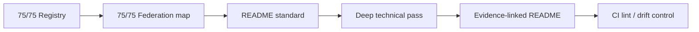

# 📚 SYNERGY — программа углубления README для 75 репозиториев

> **Цель:** довести каждый репозиторий до уровня технического досье `dlp_solver`: теория/проблема → архитектура → реальные файлы → эксперименты → evidence → ограничения → воспроизводимость → связи → roadmap.

## Текущий прогресс

- **75/75** репозиториев внесены в канонический registry.
- **75/75** имеют место в общей архитектурной карте.
- Для всех введён единый README-standard и federation navigation.
- **34/75** уже получили расширенный предметный проход или были углублены в текущей волне.
- Остальные не считаются «готовыми» только потому, что получили federation passport: для них нужен предметный deep pass.



## Определение deep pass

Deep pass считается завершённым только если README содержит по существу проекта:

1. конкретную проблему;
2. фактическую архитектуру;
3. реальный file/artifact map;
4. inputs/outputs;
5. authority/invariants;
6. тесты/benchmarks/evidence;
7. границы claims;
8. reproduction path;
9. связи с соседними репозиториями;
10. следующий проверяемый milestone.

---

# MASTER_GOVERNANCE

| Репозиторий | Deep pass | Следующий фокус |
|---|:---:|---|
| [`synergy_apps`](https://github.com/Shtenco/synergy_apps) | ✅ углублён | поддерживать синхронность evidence и architecture |
| [`synergy_megaproject`](https://github.com/Shtenco/synergy_megaproject) | ✅ углублён | поддерживать синхронность evidence и architecture |
| [`synergy_meta_os`](https://github.com/Shtenco/synergy_meta_os) | ✅ углублён | поддерживать синхронность evidence и architecture |
| [`synergy_project`](https://github.com/Shtenco/synergy_project) | ✅ углублён | поддерживать синхронность evidence и architecture |
| [`synergy_system`](https://github.com/Shtenco/synergy_system) | ✅ углублён | поддерживать синхронность evidence и architecture |

# INTELLIGENCE_AGENTS

| Репозиторий | Deep pass | Следующий фокус |
|---|:---:|---|
| [`synergy_agentic_ai_economy`](https://github.com/Shtenco/synergy_agentic_ai_economy) | 🔄 следующий проход | runtime/benchmarks/provenance/typed agent contracts |
| [`synergy_agi_autopilot`](https://github.com/Shtenco/synergy_agi_autopilot) | ✅ углублён | поддерживать синхронность evidence и architecture |
| [`synergy_agi_nexus`](https://github.com/Shtenco/synergy_agi_nexus) | ✅ углублён | поддерживать синхронность evidence и architecture |
| [`synergy_agi_olga`](https://github.com/Shtenco/synergy_agi_olga) | 🔄 следующий проход | runtime/benchmarks/provenance/typed agent contracts |
| [`synergy_ai_coder`](https://github.com/Shtenco/synergy_ai_coder) | ✅ углублён | поддерживать синхронность evidence и architecture |
| [`synergy_ai_company`](https://github.com/Shtenco/synergy_ai_company) | ✅ углублён | поддерживать синхронность evidence и architecture |
| [`synergy_ai_language`](https://github.com/Shtenco/synergy_ai_language) | 🔄 следующий проход | runtime/benchmarks/provenance/typed agent contracts |
| [`synergy_gllm_nexus`](https://github.com/Shtenco/synergy_gllm_nexus) | ✅ углублён | поддерживать синхронность evidence и architecture |
| [`synergy_nexus_science_agent`](https://github.com/Shtenco/synergy_nexus_science_agent) | 🔄 следующий проход | runtime/benchmarks/provenance/typed agent contracts |

# TRADING_MARKET_INTELLIGENCE

| Репозиторий | Deep pass | Следующий фокус |
|---|:---:|---|
| [`3D_bars_market_structure`](https://github.com/Shtenco/3D_bars_market_structure) | 🔄 следующий проход | OOS, costs, execution, artifact map |
| [`computer_vision_trading_metatrader_5`](https://github.com/Shtenco/computer_vision_trading_metatrader_5) | 🔄 следующий проход | OOS, costs, execution, artifact map |
| [`cross_forex_arbitrage_trading_metatrader_5`](https://github.com/Shtenco/cross_forex_arbitrage_trading_metatrader_5) | 🔄 следующий проход | OOS, costs, execution, artifact map |
| [`global_liquidity_dataminer`](https://github.com/Shtenco/global_liquidity_dataminer) | 🔄 следующий проход | OOS, costs, execution, artifact map |
| [`midas_lite`](https://github.com/Shtenco/midas_lite) | ✅ углублён | поддерживать синхронность evidence и architecture |
| [`multi_threaded_trading_robot_with_machine_learning_python`](https://github.com/Shtenco/multi_threaded_trading_robot_with_machine_learning_python) | 🔄 следующий проход | OOS, costs, execution, artifact map |
| [`quantum-trading_metatrader5`](https://github.com/Shtenco/quantum-trading_metatrader5) | 🔄 следующий проход | OOS, costs, execution, artifact map |
| [`swap_arbitrage_metatrader_5`](https://github.com/Shtenco/swap_arbitrage_metatrader_5) | 🔄 следующий проход | OOS, costs, execution, artifact map |
| [`synergy_adaptive_engine`](https://github.com/Shtenco/synergy_adaptive_engine) | ✅ углублён | поддерживать синхронность evidence и architecture |
| [`synergy_agi_trader`](https://github.com/Shtenco/synergy_agi_trader) | 🔄 следующий проход | OOS, costs, execution, artifact map |
| [`synergy_ai_investment_committee`](https://github.com/Shtenco/synergy_ai_investment_committee) | ✅ углублён | поддерживать синхронность evidence и architecture |
| [`synergy_ai_trade_terminal`](https://github.com/Shtenco/synergy_ai_trade_terminal) | 🔄 следующий проход | OOS, costs, execution, artifact map |
| [`synergy_algotrading_graph_system`](https://github.com/Shtenco/synergy_algotrading_graph_system) | 🔄 следующий проход | OOS, costs, execution, artifact map |
| [`synergy_crypto_pump`](https://github.com/Shtenco/synergy_crypto_pump) | 🔄 следующий проход | OOS, costs, execution, artifact map |
| [`synergy_market_graph`](https://github.com/Shtenco/synergy_market_graph) | ✅ углублён | поддерживать синхронность evidence и architecture |
| [`synergy_market_maker`](https://github.com/Shtenco/synergy_market_maker) | ✅ углублён | поддерживать синхронность evidence и architecture |
| [`synergy_marketvision`](https://github.com/Shtenco/synergy_marketvision) | ✅ углублён | поддерживать синхронность evidence и architecture |
| [`synergy_midas_ai`](https://github.com/Shtenco/synergy_midas_ai) | ✅ углублён | поддерживать синхронность evidence и architecture |
| [`synergy_midas_ai_trading_system`](https://github.com/Shtenco/synergy_midas_ai_trading_system) | 🔄 следующий проход | OOS, costs, execution, artifact map |
| [`synergy_midas_institutional`](https://github.com/Shtenco/synergy_midas_institutional) | ✅ углублён | поддерживать синхронность evidence и architecture |
| [`synergy_quantlab`](https://github.com/Shtenco/synergy_quantlab) | 🔄 следующий проход | OOS, costs, execution, artifact map |
| [`synergy_relative_value`](https://github.com/Shtenco/synergy_relative_value) | ✅ углублён | поддерживать синхронность evidence и architecture |
| [`synergy_riskguard`](https://github.com/Shtenco/synergy_riskguard) | ✅ углублён | поддерживать синхронность evidence и architecture |
| [`synergy_trademux`](https://github.com/Shtenco/synergy_trademux) | ✅ углублён | поддерживать синхронность evidence и architecture |

# FINANCE_REAL_ECONOMY

| Репозиторий | Deep pass | Следующий фокус |
|---|:---:|---|
| [`synergy_ai_financial_system`](https://github.com/Shtenco/synergy_ai_financial_system) | 🔄 следующий проход | double-entry, settlement, HardNAV, real-economy evidence |
| [`synergy_cashero`](https://github.com/Shtenco/synergy_cashero) | 🔄 следующий проход | double-entry, settlement, HardNAV, real-economy evidence |
| [`synergy_eurasian`](https://github.com/Shtenco/synergy_eurasian) | 🔄 следующий проход | double-entry, settlement, HardNAV, real-economy evidence |
| [`synergy_financial_os`](https://github.com/Shtenco/synergy_financial_os) | ✅ углублён | поддерживать синхронность evidence и architecture |
| [`synergy_matrix_sota`](https://github.com/Shtenco/synergy_matrix_sota) | ✅ углублён | поддерживать синхронность evidence и architecture |
| [`synergy_pay_system`](https://github.com/Shtenco/synergy_pay_system) | 🔄 следующий проход | double-entry, settlement, HardNAV, real-economy evidence |

# BLOCKCHAIN_MONETARY

| Репозиторий | Deep pass | Следующий фокус |
|---|:---:|---|
| [`print_money_synergychain`](https://github.com/Shtenco/print_money_synergychain) | ✅ углублён | поддерживать синхронность evidence и architecture |
| [`synergy_2chain_qe`](https://github.com/Shtenco/synergy_2chain_qe) | 🔄 следующий проход | state machine, conservation, PQ/security evidence |
| [`synergy_ai_blockchain`](https://github.com/Shtenco/synergy_ai_blockchain) | ✅ углублён | поддерживать синхронность evidence и architecture |
| [`synergy_blochain_budget`](https://github.com/Shtenco/synergy_blochain_budget) | 🔄 следующий проход | state machine, conservation, PQ/security evidence |
| [`synergy_chain`](https://github.com/Shtenco/synergy_chain) | 🔄 следующий проход | state machine, conservation, PQ/security evidence |
| [`synergy_chain_print_money`](https://github.com/Shtenco/synergy_chain_print_money) | ✅ углублён | поддерживать синхронность evidence и architecture |
| [`synergy_graph_print_money`](https://github.com/Shtenco/synergy_graph_print_money) | 🔄 следующий проход | state machine, conservation, PQ/security evidence |
| [`synergy_metachain`](https://github.com/Shtenco/synergy_metachain) | ✅ углублён | поддерживать синхронность evidence и architecture |
| [`synergy_qe`](https://github.com/Shtenco/synergy_qe) | ✅ углублён | поддерживать синхронность evidence и architecture |
| [`synergy_usds`](https://github.com/Shtenco/synergy_usds) | 🔄 следующий проход | state machine, conservation, PQ/security evidence |

# INFRA_NETWORK_SECURITY

| Репозиторий | Deep pass | Следующий фокус |
|---|:---:|---|
| [`dlp_solver`](https://github.com/Shtenco/dlp_solver) | 🔄 следующий проход | protocol/runtime benchmarks, threat model, reproducibility |
| [`synegy_ai_compress`](https://github.com/Shtenco/synegy_ai_compress) | 🔄 следующий проход | protocol/runtime benchmarks, threat model, reproducibility |
| [`synergy_gguf_compress`](https://github.com/Shtenco/synergy_gguf_compress) | ✅ углублён | поддерживать синхронность evidence и architecture |
| [`synergy_motherboard_xpu_xml`](https://github.com/Shtenco/synergy_motherboard_xpu_xml) | 🔄 следующий проход | protocol/runtime benchmarks, threat model, reproducibility |
| [`synergy_net`](https://github.com/Shtenco/synergy_net) | 🔄 следующий проход | protocol/runtime benchmarks, threat model, reproducibility |
| [`synergy_post_quantum_radio`](https://github.com/Shtenco/synergy_post_quantum_radio) | ✅ углублён | поддерживать синхронность evidence и architecture |
| [`synergy_qr_compress`](https://github.com/Shtenco/synergy_qr_compress) | 🔄 следующий проход | protocol/runtime benchmarks, threat model, reproducibility |
| [`synergy_shhts`](https://github.com/Shtenco/synergy_shhts) | ✅ углублён | поддерживать синхронность evidence и architecture |
| [`synergy_shttps`](https://github.com/Shtenco/synergy_shttps) | ✅ углублён | поддерживать синхронность evidence и architecture |
| [`synergy_turbo_linux`](https://github.com/Shtenco/synergy_turbo_linux) | 🔄 следующий проход | protocol/runtime benchmarks, threat model, reproducibility |

# APPS_INTERFACES

| Репозиторий | Deep pass | Следующий фокус |
|---|:---:|---|
| [`shtenco.github.io`](https://github.com/Shtenco/shtenco.github.io) | 🔄 следующий проход | screen/data flow, API authority, release/security |
| [`shtencoauantai.github.io`](https://github.com/Shtenco/shtencoauantai.github.io) | 🔄 следующий проход | screen/data flow, API authority, release/security |
| [`sinergy_app`](https://github.com/Shtenco/sinergy_app) | ✅ углублён | поддерживать синхронность evidence и architecture |
| [`sinergy_super_app`](https://github.com/Shtenco/sinergy_super_app) | 🔄 следующий проход | screen/data flow, API authority, release/security |
| [`synergy_app`](https://github.com/Shtenco/synergy_app) | 🔄 следующий проход | screen/data flow, API authority, release/security |
| [`synergy_app_family`](https://github.com/Shtenco/synergy_app_family) | ✅ углублён | поддерживать синхронность evidence и architecture |
| [`synergy_messenger`](https://github.com/Shtenco/synergy_messenger) | 🔄 следующий проход | screen/data flow, API authority, release/security |
| [`synergychain.github.io`](https://github.com/Shtenco/synergychain.github.io) | 🔄 следующий проход | screen/data flow, API authority, release/security |

# SCIENCE_RESEARCH

| Репозиторий | Deep pass | Следующий фокус |
|---|:---:|---|
| [`binary_quantum_theory`](https://github.com/Shtenco/binary_quantum_theory) | 🔄 следующий проход | hypotheses, falsification, source/evidence graph |
| [`epstein_network`](https://github.com/Shtenco/epstein_network) | 🔄 следующий проход | hypotheses, falsification, source/evidence graph |
| [`synergy_cold_nuclear`](https://github.com/Shtenco/synergy_cold_nuclear) | 🔄 следующий проход | hypotheses, falsification, source/evidence graph |

# Правило дальнейшей работы

Нельзя считать задачу закрытой массовой вставкой одинакового текста.

Для каждого оставшегося репозитория второй проход должен начинаться с чтения:

```text
README
+ root tree
+ docs/
+ tests/
+ evidence/reports/
+ manifests/config
+ active implementation branches where explicitly referenced
```

И только затем README дополняется предметной документацией.

# Definition of Done для всей федерации

```text
75 registry entries
+ 75 resolvable README
+ 75 federation passports
+ 75 domain-specific deep passes
+ no stale canonical repo names
+ no 45/46 count presented as current
+ machine-checkable registry
+ typed authority boundaries
+ CI drift checks
= DOCUMENTATION FEDERATION COMPLETE
```
