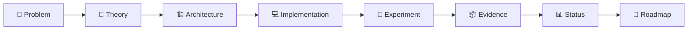

# 📘 SYNERGY README STANDARD

> Канонический стандарт документации для всех репозиториев федерации Shtenco/SYNERGY.

## Цель

README должен быть не рекламной обложкой, а **техническим паспортом проекта**: человек или AI-агент должны понять проблему, роль, архитектуру, доказательства, ограничения, связи и способ воспроизведения результата.

## Обязательная структура

1. `# Название + иконографика`
2. `🎯 Задача / проблема`
3. `🧠 Главная идея / теория`
4. `🏗️ Архитектура` с Mermaid
5. `📥 Inputs / 📤 Outputs`
6. `🛡️ Authority boundaries / invariants`
7. `🧪 Эксперименты и evidence`
8. `📊 Текущий статус` с GREEN/CANDIDATE/R&D/STUB/LEGACY/RED
9. `🛠️ Воспроизводимость`
10. `🗺️ Карта репозитория`
11. `🔗 Место в SYNERGY`
12. `🚀 Roadmap`
13. `🛑 Что проект НЕ утверждает`
14. ссылки на канонический атлас и registry.

## Базовая схема



## Эпистемическая шкала

| Метка | Разрешённое значение |
|---|---|
| ✅ GREEN | воспроизводимо подтверждено |
| 🟡 CANDIDATE | есть реализация, но доказательство неполное |
| 🔬 R&D | исследовательский эксперимент |
| 🧱 STUB | архитектурный узел без достаточной реализации |
| 🕰️ LEGACY | исторический provenance |
| ❌ RED | тезис не прошёл проверку |

## Запрещённые подмены

```text
generated code        != validated code
backtest              != realized P&L
mint/rebase           != external profit
UI state              != ledger truth
blockchain commitment != accounting truth
benchmark             != general capability
architecture diagram  != runtime integration
repository name       != proof of implementation
```

## Обязательная федерационная навигация

- [SYNERGY SYSTEM](https://github.com/Shtenco/synergy_system)
- [Атлас всех 75 репозиториев](https://github.com/Shtenco/synergy_system/blob/main/docs/SYNERGY_REPOSITORY_ATLAS.md)
- [Машиночитаемый registry](https://github.com/Shtenco/synergy_system/blob/main/registry/SYNERGY_REPOSITORIES.json)

## Критерий качества

Эталоном по глубине служит `dlp_solver`: README должен отделять **что измерено** от **что предполагается**, показывать конкретные числа, bottleneck, отрицательные результаты и следующий проверяемый рубеж.

Большой README допустим, но при очень больших объёмах детали следует выносить в `docs/`, оставляя в корне навигационную карту и краткий evidence-led summary.
