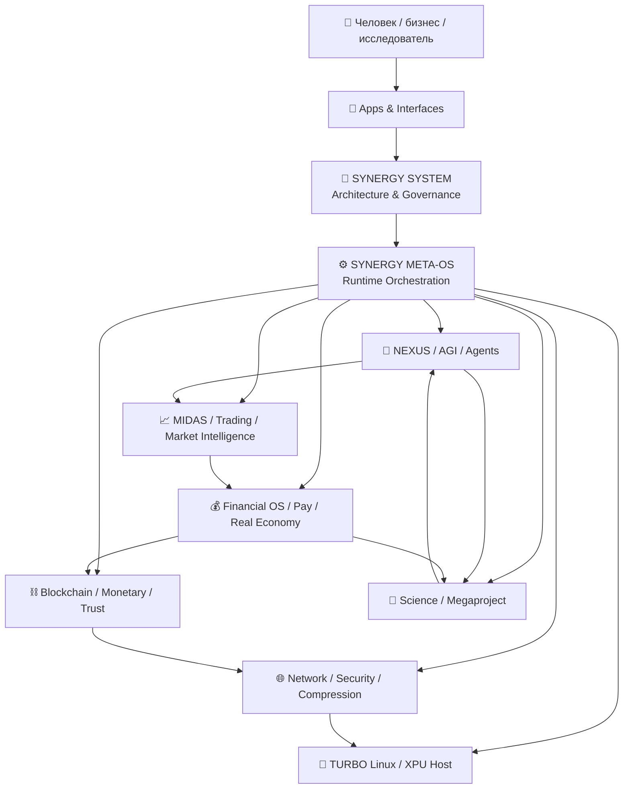
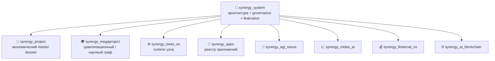
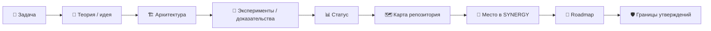
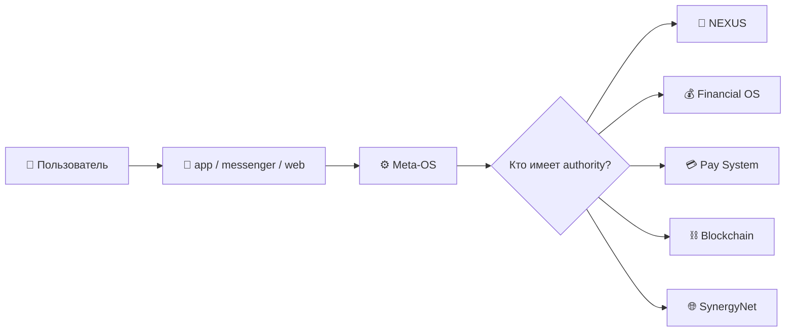
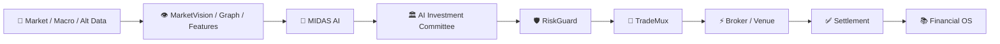
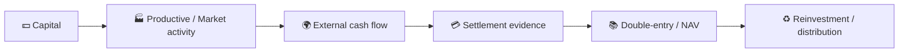
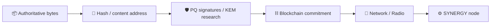

# 🧭 SYNERGY — Атлас 75 репозиториев

> **Каноническая карта федерации Shtenco/SYNERGY.**  
> Архитектурный корень: [`Shtenco/synergy_system`](https://github.com/Shtenco/synergy_system)  
> Экономический master dossier: [`Shtenco/synergy_project`](https://github.com/Shtenco/synergy_project)  
> Цивилизационный граф: [`Shtenco/synergy_megaproject`](https://github.com/Shtenco/synergy_megaproject)  
> Runtime-оркестратор узла: [`Shtenco/synergy_meta_os`](https://github.com/Shtenco/synergy_meta_os)  
> **Срез реестра: 28 сентября 2026 · 75 репозиториев.**

---

## 🎯 Зачем нужен этот документ

SYNERGY больше нельзя корректно описывать как один репозиторий или один продукт. Это **федерация специализированных систем**, где разные репозитории отвечают за разные типы истины и не должны незаметно подменять друг друга.

Этот атлас решает четыре задачи:

1. показывает место каждого репозитория в общей системе;
2. отделяет архитектурную связь от доказанной runtime/code dependency;
3. задаёт единый стандарт README, аналогичный по глубине `dlp_solver`;
4. даёт человеку и AI-агенту единую точку входа в 75-репозиторную систему.

---

# 🧠 Система в одной схеме



## Ключевой принцип

```text
AI proposes            != monetary authority
payment evidence       != revenue
revenue                != profit
mint                    != external wealth
blockchain commitment  != economic truth by itself
UI state               != ledger state
service running        != service authorized
research hypothesis    != proven technology
```

---

# 🏛️ Иерархия мастер-репозиториев



### Семантика связей

| Тип | Смысл |
|---|---|
| **AUTHORITY** | Репозиторий является источником истины для своей области. |
| **ORCHESTRATES** | Запускает/координирует другие сервисы, но не присваивает их полномочия. |
| **CONSUMES** | Потребляет данные/артефакты другого слоя. |
| **PROVIDES** | Предоставляет данные/сервис/артефакт другому слою. |
| **R&D LINEAGE** | Исследовательская предыстория или экспериментальная ветка. |
| **PRESENTATION** | UI/сайт/витрина; не источник финансовой или научной истины. |
| **ARCHITECTURAL RELATION** | Связь в федерации документации; сама по себе не доказывает runtime dependency. |

---

# 📚 Единый стандарт README

Каждый репозиторий федерации должен иметь README с теми же дисциплинами, которые хорошо видны в `dlp_solver`:



Минимально обязательны:

- понятная цель и роль;
- Mermaid/иконографика;
- архитектура;
- входы/выходы и authority boundaries;
- статус доказанности;
- воспроизводимость;
- карта файлов;
- связи с соседними репозиториями;
- roadmap;
- раздел «что проект НЕ утверждает»;
- ссылка на этот канонический атлас.

---

# 🧭 Полный реестр

> Поле «родитель» ниже означает **архитектурный родитель в документации**, а не автоматически доказанную импортом/деплоем code dependency.


## 📱 Apps / interfaces

| Репозиторий | Роль в системе | Архитектурный родитель |
|---|---|---|
| [`shtenco.github.io`](https://github.com/Shtenco/shtenco.github.io) | Публичная web-витрина и навигационный интерфейс к проектам Shtenco. | [`synergy_apps`](https://github.com/Shtenco/synergy_apps) |
| [`shtencoauantai.github.io`](https://github.com/Shtenco/shtencoauantai.github.io) | Публичный web-интерфейс/сайт для представления отдельных направлений экосистемы. | [`synergy_apps`](https://github.com/Shtenco/synergy_apps) |
| [`sinergy_app`](https://github.com/Shtenco/sinergy_app) | Приложенческий shell/концепт SINERGY. | [`synergy_apps`](https://github.com/Shtenco/synergy_apps) |
| [`sinergy_super_app`](https://github.com/Shtenco/sinergy_super_app) | Концептуальная/продуктовая оболочка super-app для пользовательских сервисов SINERGY. | [`synergy_apps`](https://github.com/Shtenco/synergy_apps) |
| [`synergy_app`](https://github.com/Shtenco/synergy_app) | Пользовательский финансовый интерфейс/приложение SINERGY. | [`synergy_apps`](https://github.com/Shtenco/synergy_apps) |
| [`synergy_app_family`](https://github.com/Shtenco/synergy_app_family) | Концептуальный семейный продуктовый слой/семейство приложений. | [`synergy_apps`](https://github.com/Shtenco/synergy_apps) |
| [`synergy_messenger`](https://github.com/Shtenco/synergy_messenger) | Мессенджер/коммуникационный слой SYNERGY и пользовательская клиентская оболочка. | [`synergy_apps`](https://github.com/Shtenco/synergy_apps) |
| [`synergychain.github.io`](https://github.com/Shtenco/synergychain.github.io) | Публичная web-витрина SINERGYCHAIN. | [`synergy_apps`](https://github.com/Shtenco/synergy_apps) |

## ⛓️ Blockchain / monetary systems

| Репозиторий | Роль в системе | Архитектурный родитель |
|---|---|---|
| [`print_money_synergychain`](https://github.com/Shtenco/print_money_synergychain) | R&D по программируемой эмиссии, ликвидности, mint/burn и внешне обеспеченному экономическому эффекту. | [`synergy_ai_blockchain`](https://github.com/Shtenco/synergy_ai_blockchain) |
| [`synergy_2chain_qe`](https://github.com/Shtenco/synergy_2chain_qe) | Двухцепочечный QE/арбитражный R&D и модели ликвидности на fork/DeFi окружениях. | [`synergy_ai_blockchain`](https://github.com/Shtenco/synergy_ai_blockchain) |
| [`synergy_ai_blockchain`](https://github.com/Shtenco/synergy_ai_blockchain) | Блокчейн/доверительный слой SYNERGY, включая PQ/EVM и привязку проверяемых состояний. | [`synergy_ai_blockchain`](https://github.com/Shtenco/synergy_ai_blockchain) |
| [`synergy_blochain_budget`](https://github.com/Shtenco/synergy_blochain_budget) | Блокчейн-трассируемость бюджетов/потоков и provenance финансовых операций. | [`synergy_ai_blockchain`](https://github.com/Shtenco/synergy_ai_blockchain) |
| [`synergy_chain`](https://github.com/Shtenco/synergy_chain) | Экспериментальная блокчейн- и token/economic-ветка SINERGYCHAIN. | [`synergy_ai_blockchain`](https://github.com/Shtenco/synergy_ai_blockchain) |
| [`synergy_chain_print_money`](https://github.com/Shtenco/synergy_chain_print_money) | Концептуальный узел интеграции chain-механики и monetary/emission R&D. | [`synergy_ai_blockchain`](https://github.com/Shtenco/synergy_ai_blockchain) |
| [`synergy_graph_print_money`](https://github.com/Shtenco/synergy_graph_print_money) | Графовый Economic OS / денежная топология и исследование внешне-обеспеченных контуров эмиссии. | [`synergy_ai_blockchain`](https://github.com/Shtenco/synergy_ai_blockchain) |
| [`synergy_metachain`](https://github.com/Shtenco/synergy_metachain) | Cross-chain/bridge архитектура и правила уникального lock/burn → mint/claim соответствия. | [`synergy_ai_blockchain`](https://github.com/Shtenco/synergy_ai_blockchain) |
| [`synergy_qe`](https://github.com/Shtenco/synergy_qe) | Концептуальный узел QE Engine; текущий main содержит только минимальный README. | [`synergy_ai_blockchain`](https://github.com/Shtenco/synergy_ai_blockchain) |
| [`synergy_usds`](https://github.com/Shtenco/synergy_usds) | Экспериментальная денежная/стейблкоин-модель USDS и Base-fork экономика. | [`synergy_ai_blockchain`](https://github.com/Shtenco/synergy_ai_blockchain) |

## 💰 Finance / real economy

| Репозиторий | Роль в системе | Архитектурный родитель |
|---|---|---|
| [`synergy_ai_financial_system`](https://github.com/Shtenco/synergy_ai_financial_system) | R&D по AI-управлению финансовыми моделями, капиталом и экономическими контурами. | [`synergy_financial_os`](https://github.com/Shtenco/synergy_financial_os) |
| [`synergy_cashero`](https://github.com/Shtenco/synergy_cashero) | Финансово-экономическая R&D-ветка, связанная с денежными потоками и платёжными сценариями. | [`synergy_financial_os`](https://github.com/Shtenco/synergy_financial_os) |
| [`synergy_eurasian`](https://github.com/Shtenco/synergy_eurasian) | Контур реальной экономики/индустрии и долгосрочной экономической архитектуры EURASIAN. | [`synergy_financial_os`](https://github.com/Shtenco/synergy_financial_os) |
| [`synergy_financial_os`](https://github.com/Shtenco/synergy_financial_os) | Канонический финансовый слой: учёт, NAV, обязательства, ликвидность, риск и экономическая истинность. | [`synergy_financial_os`](https://github.com/Shtenco/synergy_financial_os) |
| [`synergy_matrix_sota`](https://github.com/Shtenco/synergy_matrix_sota) | Владелец части debt/credit lifecycle механизмов и матричной оценки зрелости/архитектуры. | [`synergy_financial_os`](https://github.com/Shtenco/synergy_financial_os) |
| [`synergy_pay_system`](https://github.com/Shtenco/synergy_pay_system) | Платёжные маршруты, котировки, settlement/reconciliation и MetaPay-подобные контуры. | [`synergy_financial_os`](https://github.com/Shtenco/synergy_financial_os) |

## 🛡️ Infrastructure / network / security / compression

| Репозиторий | Роль в системе | Архитектурный родитель |
|---|---|---|
| [`dlp_solver`](https://github.com/Shtenco/dlp_solver) | Reverse-EXP / anti-exponential cryptographic research lab с эпистемической дисциплиной и воспроизводимыми экспериментами. | [`synergy_meta_os`](https://github.com/Shtenco/synergy_meta_os) |
| [`synegy_ai_compress`](https://github.com/Shtenco/synegy_ai_compress) | R&D по компрессии AI-данных/моделей и архивному субстрату. | [`synergy_meta_os`](https://github.com/Shtenco/synergy_meta_os) |
| [`synergy_gguf_compress`](https://github.com/Shtenco/synergy_gguf_compress) | Лаборатория компрессии GGUF/LLM-моделей; на текущем main README остаётся минимальным, поэтому зрелость не предполагается. | [`synergy_meta_os`](https://github.com/Shtenco/synergy_meta_os) |
| [`synergy_motherboard_xpu_xml`](https://github.com/Shtenco/synergy_motherboard_xpu_xml) | Экспериментальный аппаратно-описательный слой XPU/EML и конфигурация вычислительной платформы. | [`synergy_meta_os`](https://github.com/Shtenco/synergy_meta_os) |
| [`synergy_net`](https://github.com/Shtenco/synergy_net) | P2P/mesh/data-plane сеть и транспорт между узлами SYNERGY. | [`synergy_meta_os`](https://github.com/Shtenco/synergy_meta_os) |
| [`synergy_post_quantum_radio`](https://github.com/Shtenco/synergy_post_quantum_radio) | Концептуальный узел post-quantum radio/physical transport; текущий main пока не доказывает готовую реализацию. | [`synergy_meta_os`](https://github.com/Shtenco/synergy_meta_os) |
| [`synergy_qr_compress`](https://github.com/Shtenco/synergy_qr_compress) | Temporal dictionary / QR-compression R&D и повторное использование общей структуры данных. | [`synergy_meta_os`](https://github.com/Shtenco/synergy_meta_os) |
| [`synergy_shhts`](https://github.com/Shtenco/synergy_shhts) | Экспериментальный security/transport placeholder; назначение должно подтверждаться будущими артефактами, а не названием. | [`synergy_meta_os`](https://github.com/Shtenco/synergy_meta_os) |
| [`synergy_shttps`](https://github.com/Shtenco/synergy_shttps) | Экспериментальный secure-transport/HTTPS-like placeholder; реализация пока не должна считаться доказанной по одному названию. | [`synergy_meta_os`](https://github.com/Shtenco/synergy_meta_os) |
| [`synergy_turbo_linux`](https://github.com/Shtenco/synergy_turbo_linux) | Хостовый/OS-слой SYNERGY: системная изоляция, сервисы, устройство узла и экспериментальный runtime. | [`synergy_meta_os`](https://github.com/Shtenco/synergy_meta_os) |

## 🧠 Intelligence / agents

| Репозиторий | Роль в системе | Архитектурный родитель |
|---|---|---|
| [`synergy_agentic_ai_economy`](https://github.com/Shtenco/synergy_agentic_ai_economy) | Экономика AI-агентов: задания, контракты, рынки, заработок и agent-to-agent workflows. | [`synergy_agi_nexus`](https://github.com/Shtenco/synergy_agi_nexus) |
| [`synergy_agi_autopilot`](https://github.com/Shtenco/synergy_agi_autopilot) | Агентный автопилот: планирование задач, DAG/оркестрация и ограниченное автономное исполнение. | [`synergy_agi_nexus`](https://github.com/Shtenco/synergy_agi_nexus) |
| [`synergy_agi_nexus`](https://github.com/Shtenco/synergy_agi_nexus) | Каноническая архитектура AGI NEXUS и поколений reasoning/world-model исследований. | [`synergy_agi_nexus`](https://github.com/Shtenco/synergy_agi_nexus) |
| [`synergy_agi_olga`](https://github.com/Shtenco/synergy_agi_olga) | Историческая линия OLGA/AGI и источник части поколений NEXUS. | [`synergy_agi_nexus`](https://github.com/Shtenco/synergy_agi_nexus) |
| [`synergy_ai_coder`](https://github.com/Shtenco/synergy_ai_coder) | Подсистема AI Coder и воспроизводимый compiler/build-tooling контур. | [`synergy_agi_nexus`](https://github.com/Shtenco/synergy_agi_nexus) |
| [`synergy_ai_company`](https://github.com/Shtenco/synergy_ai_company) | Концепт AI-native компании: агенты, процессы, контракты и автоматизация организации. | [`synergy_agi_nexus`](https://github.com/Shtenco/synergy_agi_nexus) |
| [`synergy_ai_language`](https://github.com/Shtenco/synergy_ai_language) | Семантический и языковой слой: формализация, язык взаимодействия и AI language tooling. | [`synergy_agi_nexus`](https://github.com/Shtenco/synergy_agi_nexus) |
| [`synergy_gllm_nexus`](https://github.com/Shtenco/synergy_gllm_nexus) | Активный research runtime NEXUS/GLLM, бенчмарки, замороженные OOS-протоколы и генерации. | [`synergy_agi_nexus`](https://github.com/Shtenco/synergy_agi_nexus) |
| [`synergy_nexus_science_agent`](https://github.com/Shtenco/synergy_nexus_science_agent) | Научный агент NEXUS: поиск, гипотезы, доказательства и исследовательская оркестрация. | [`synergy_agi_nexus`](https://github.com/Shtenco/synergy_agi_nexus) |

## 🧭 Master / governance

| Репозиторий | Роль в системе | Архитектурный родитель |
|---|---|---|
| [`synergy_apps`](https://github.com/Shtenco/synergy_apps) | Реестр и master-слой пользовательских приложений SYNERGY. | [`synergy_system`](https://github.com/Shtenco/synergy_system) |
| [`synergy_megaproject`](https://github.com/Shtenco/synergy_megaproject) | Цивилизационный master-graph: мегапроекты, фронтирные технологии, научные идеи и их доказательные связи. | [`synergy_system`](https://github.com/Shtenco/synergy_system) |
| [`synergy_meta_os`](https://github.com/Shtenco/synergy_meta_os) | Runtime-оркестратор полного узла SYNERGY поверх host OS и сетевых/AI/финансовых сервисов. | [`synergy_system`](https://github.com/Shtenco/synergy_system) |
| [`synergy_project`](https://github.com/Shtenco/synergy_project) | Master dossier: экономическая и продуктовая картина SYNERGY поверх архитектурного корня. | [`synergy_system`](https://github.com/Shtenco/synergy_system) |
| [`synergy_system`](https://github.com/Shtenco/synergy_system) | Главный архитектурный и governance-корень всей федерации SYNERGY. | — |

## 🔬 Science / research

| Репозиторий | Роль в системе | Архитектурный родитель |
|---|---|---|
| [`binary_quantum_theory`](https://github.com/Shtenco/binary_quantum_theory) | Теоретико-физическая исследовательская ветка Binary Quantum Gravity. | [`synergy_megaproject`](https://github.com/Shtenco/synergy_megaproject) |
| [`epstein_network`](https://github.com/Shtenco/epstein_network) | Отдельный исследовательский knowledge-graph/дистиллированный граф источников; не runtime-компонент финансовой системы. | [`synergy_megaproject`](https://github.com/Shtenco/synergy_megaproject) |
| [`synergy_cold_nuclear`](https://github.com/Shtenco/synergy_cold_nuclear) | Воспроизводимый вычислительный R&D-контур для исследований низкоэнергетических/«cold nuclear» гипотез. | [`synergy_megaproject`](https://github.com/Shtenco/synergy_megaproject) |

## 📈 Trading / market intelligence

| Репозиторий | Роль в системе | Архитектурный родитель |
|---|---|---|
| [`3D_bars_market_structure`](https://github.com/Shtenco/3D_bars_market_structure) | Эксперименты с трёхмерным представлением цена-время-объём и рыночной структурой. | [`synergy_midas_ai`](https://github.com/Shtenco/synergy_midas_ai) |
| [`computer_vision_trading_metatrader_5`](https://github.com/Shtenco/computer_vision_trading_metatrader_5) | Исследования компьютерного зрения для распознавания рыночных структур и торговых сигналов. | [`synergy_midas_ai`](https://github.com/Shtenco/synergy_midas_ai) |
| [`cross_forex_arbitrage_trading_metatrader_5`](https://github.com/Shtenco/cross_forex_arbitrage_trading_metatrader_5) | Исследовательский движок cross-FX и синтетического валютного арбитража. | [`synergy_midas_ai`](https://github.com/Shtenco/synergy_midas_ai) |
| [`global_liquidity_dataminer`](https://github.com/Shtenco/global_liquidity_dataminer) | Сбор и подготовка глобальных макроликвидностных данных для рыночных моделей. | [`synergy_midas_ai`](https://github.com/Shtenco/synergy_midas_ai) |
| [`midas_lite`](https://github.com/Shtenco/midas_lite) | Облегчённая исследовательская ветка MIDAS с торговыми прототипами и системами. | [`synergy_midas_ai`](https://github.com/Shtenco/synergy_midas_ai) |
| [`multi_threaded_trading_robot_with_machine_learning_python`](https://github.com/Shtenco/multi_threaded_trading_robot_with_machine_learning_python) | Многопоточный ML-прототип торгового робота на Python. | [`synergy_midas_ai`](https://github.com/Shtenco/synergy_midas_ai) |
| [`quantum-trading_metatrader5`](https://github.com/Shtenco/quantum-trading_metatrader5) | Ранняя R&D-линия квантово-ассистированного трейдинга и интеграции с MetaTrader 5. | [`synergy_midas_ai`](https://github.com/Shtenco/synergy_midas_ai) |
| [`swap_arbitrage_metatrader_5`](https://github.com/Shtenco/swap_arbitrage_metatrader_5) | R&D по swap/carry-арбитражу и синтетическим портфелям в MetaTrader 5. | [`synergy_midas_ai`](https://github.com/Shtenco/synergy_midas_ai) |
| [`synergy_adaptive_engine`](https://github.com/Shtenco/synergy_adaptive_engine) | Адаптивный движок параметров/режимов и переключения политик по состоянию рынка. | [`synergy_midas_ai`](https://github.com/Shtenco/synergy_midas_ai) |
| [`synergy_agi_trader`](https://github.com/Shtenco/synergy_agi_trader) | AGI/AI трейдер: объединение reasoning и торговых контуров под риск-ограничениями. | [`synergy_midas_ai`](https://github.com/Shtenco/synergy_midas_ai) |
| [`synergy_ai_investment_committee`](https://github.com/Shtenco/synergy_ai_investment_committee) | AI investment committee: агрегирование исследований и формирование ограниченных инвестиционных рекомендаций. | [`synergy_midas_ai`](https://github.com/Shtenco/synergy_midas_ai) |
| [`synergy_ai_trade_terminal`](https://github.com/Shtenco/synergy_ai_trade_terminal) | Терминал и управляющий интерфейс для AI/algorithmic trading workloads. | [`synergy_midas_ai`](https://github.com/Shtenco/synergy_midas_ai) |
| [`synergy_algotrading_graph_system`](https://github.com/Shtenco/synergy_algotrading_graph_system) | Графовая архитектура алгоритмического трейдинга, маршрутов и взаимосвязанных рыночных состояний. | [`synergy_midas_ai`](https://github.com/Shtenco/synergy_midas_ai) |
| [`synergy_crypto_pump`](https://github.com/Shtenco/synergy_crypto_pump) | ML-исследования раннего обнаружения криптовалютных импульсов/pump-режимов. | [`synergy_midas_ai`](https://github.com/Shtenco/synergy_midas_ai) |
| [`synergy_market_graph`](https://github.com/Shtenco/synergy_market_graph) | Граф рыночных сущностей, зависимостей и отношений для моделей/стратегий. | [`synergy_midas_ai`](https://github.com/Shtenco/synergy_midas_ai) |
| [`synergy_market_maker`](https://github.com/Shtenco/synergy_market_maker) | Market-making R&D: котирование, inventory/risk и микроструктурные контуры. | [`synergy_midas_ai`](https://github.com/Shtenco/synergy_midas_ai) |
| [`synergy_marketvision`](https://github.com/Shtenco/synergy_marketvision) | Рыночное восприятие/vision-layer для признаков, режимов и структур. | [`synergy_midas_ai`](https://github.com/Shtenco/synergy_midas_ai) |
| [`synergy_midas_ai`](https://github.com/Shtenco/synergy_midas_ai) | Интегрированный слой MIDAS AI: рыночный интеллект, модели и стратегия. | [`synergy_midas_ai`](https://github.com/Shtenco/synergy_midas_ai) |
| [`synergy_midas_ai_trading_system`](https://github.com/Shtenco/synergy_midas_ai_trading_system) | Техническая и экспериментальная ветка MIDAS AI trading system. | [`synergy_midas_ai`](https://github.com/Shtenco/synergy_midas_ai) |
| [`synergy_midas_institutional`](https://github.com/Shtenco/synergy_midas_institutional) | Институциональная архитектура MIDAS и интеграция data→model→portfolio→risk→execution. | [`synergy_midas_ai`](https://github.com/Shtenco/synergy_midas_ai) |
| [`synergy_quantlab`](https://github.com/Shtenco/synergy_quantlab) | Quant R&D лаборатория для исследований стратегий, данных и статистических проверок. | [`synergy_midas_ai`](https://github.com/Shtenco/synergy_midas_ai) |
| [`synergy_relative_value`](https://github.com/Shtenco/synergy_relative_value) | Relative-value/market-neutral исследования и сравнение относительных оценок. | [`synergy_midas_ai`](https://github.com/Shtenco/synergy_midas_ai) |
| [`synergy_riskguard`](https://github.com/Shtenco/synergy_riskguard) | Независимый риск-контур, лимиты и veto-политики для торговых/финансовых систем. | [`synergy_midas_ai`](https://github.com/Shtenco/synergy_midas_ai) |
| [`synergy_trademux`](https://github.com/Shtenco/synergy_trademux) | Маршрутизация и мультиплексирование торговых intents/стратегий к исполнимым каналам. | [`synergy_midas_ai`](https://github.com/Shtenco/synergy_midas_ai) |

---

# 🔄 Главные межсистемные контуры

## 1. Человек → приложение → runtime → authority



UI не становится вторым ledger; Meta-OS не становится финансовым authority; AI не получает право перемещать деньги только потому, что умеет планировать.

## 2. Данные → интеллект → риск → исполнение



## 3. Экономика → внешняя стоимость → учёт



## 4. Доверие и постквантовый транспорт



---

# 🧪 Эпистемическая дисциплина

Для всех 75 репозиториев действует единая шкала:

| Метка | Значение |
|---|---|
| ✅ **GREEN** | Воспроизводимо подтверждено артефактами/тестами. |
| 🟡 **CANDIDATE** | Есть реализация/данные, но доказательство неполное. |
| 🔬 **R&D** | Исследовательская гипотеза или эксперимент. |
| 🧱 **STUB** | Архитектурный узел/README существует, полноценная реализация не доказана. |
| 🕰️ **LEGACY** | Историческая линия, сохраняемая ради provenance. |
| ❌ **RED** | Проверка провалена или тезис опровергнут. |

Ни название репозитория, ни диаграмма, ни наличие кода не переводят тезис автоматически в GREEN.

---

# 🗺️ Правило навигации

Каждый дочерний README должен содержать:

```text
SYNERGY SYSTEM
   ↓
domain master
   ↓
this repository
   ↓
related repositories
   ↓
inputs / outputs / evidence
```

И обратную ссылку:

- [SYNERGY SYSTEM](https://github.com/Shtenco/synergy_system)
- [Канонический атлас 75 репозиториев](https://github.com/Shtenco/synergy_system/blob/main/docs/SYNERGY_REPOSITORY_ATLAS.md)
- [Машиночитаемый реестр](https://github.com/Shtenco/synergy_system/blob/main/registry/SYNERGY_REPOSITORIES.json)

---

# 🚀 Следующий уровень

После унификации README документация должна стать не только красивой, но и проверяемой машиной:

1. проверять, что все 75 README содержат системный паспорт;
2. проверять битые cross-repo links;
3. проверять authority conflicts;
4. строить Mermaid/Graphviz карту из JSON registry;
5. автоматически помечать STUB/LEGACY/R&D;
6. не позволять README утверждать GREEN без evidence artifact;
7. синхронизировать количество репозиториев и master links через CI.

---

## Коротко

```text
75 repositories
      ↓
one architecture root
      ↓
domain authorities
      ↓
explicit relations
      ↓
evidence-aware README
      ↓
one navigable SYNERGY system
```

**Цель документации — сделать федерацию понятной человеку и однозначной для AI-агентов, не подменяя красивой схемой реальные доказательства.**
