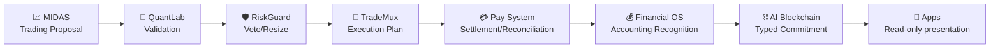
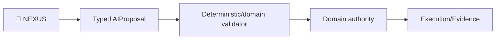
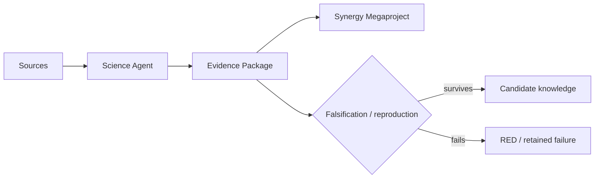
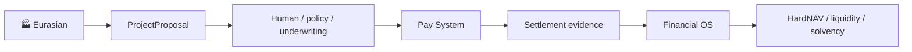
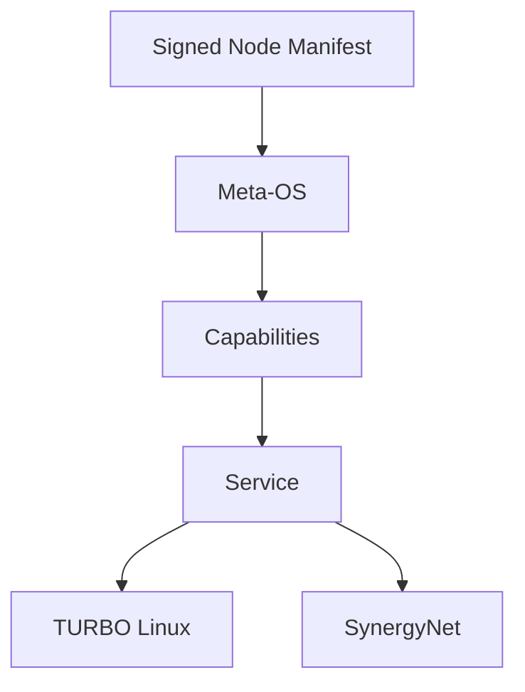

# 🧠 SYNERGY SYSTEM SEMANTIC MODEL V1

> Формальная модель всей системы SYNERGY после глубокого аудита 75 репозиториев.

## 1. Главный вывод

SYNERGY правильнее описывать не как «суперприложение» и не как «один AGI/блокчейн», а как **федеративную операционную систему независимых типов истины**.

Каждый домен владеет только своим фактом:

```text
INTELLIGENCE  → что модель вывела / предложила
VALIDATION    → что выдержало заданный протокол проверки
RISK          → что допустимо по риск-конституции
EXECUTION     → что реально было отправлено/исполнено
SETTLEMENT    → что реально завершено у внешнего провайдера
ACCOUNTING    → что экономически означает завершённое событие
TRUST         → какой authoritative payload криптографически зафиксирован
TRANSPORT     → что доставлено по сети
RUNTIME       → какой сервис/артефакт разрешён и запущен
PRESENTATION  → что показано человеку
```

Ни один слой не наследует authority предыдущего автоматически.

## 2. Главный экономический контур



Смысл переходов:

```text
proposal != validated proposal
validated proposal != risk-approved intent
risk-approved intent != fill
fill != settlement
settlement != revenue
revenue != distributable profit
accounting fact != blockchain-created fact
blockchain commitment != UI-created truth
```

## 3. AI-контур



NEXUS — **proposal authority**, а не authority платежа, бухгалтерии, консенсуса или production deployment.

## 4. Научный контур



Scientific contract обязан хранить различие:
`SOURCE / DERIVED / SIMULATION / HYPOTHESIS / MEASURED / FALSIFIED`.

## 5. Реальная экономика



Optimizer/project proposal не может сам себя профинансировать.

## 6. Runtime / host / network



`root privilege != economic authority`. Meta-OS управляет lifecycle, но domain permissions задаются отдельными capabilities и подписями.

## 7. Trust layer

Financial OS должен передавать в blockchain **canonical bytes + schema/version + authority identity + content digest**. Blockchain подтверждает неизменность/финальность этих bytes, но не переинтерпретирует бухгалтерский смысл.

## 8. Контрактная единица

Каждый межрепозиторный artifact должен содержать:

```text
contract_id
schema_version
event_id
trace_id
producer
authority
produced_at
payload
payload_sha256
evidence_ids[]
parent_event_ids[]
```

Все денежные и security-sensitive действия дополнительно требуют:
- idempotency key;
- state/version binding;
- expiry/staleness policy;
- authorization provenance;
- deterministic failure semantics.

## 9. Evidence ID

Канонический формат:

```text
urn:synergy:evidence:<repo>:<kind>:sha256:<64-hex>
```

Evidence ID идентифицирует байты/артефакт. Он **не означает автоматически**, что claim истинный.

## 10. Trace ID

Один `trace_id` должен проходить через весь бизнес-процесс:

```text
MIDAS proposal
→ QuantLab evaluation
→ RiskGuard decision
→ TradeMux plan/fills
→ Pay settlement
→ Financial OS recognition
→ blockchain commitment
```

Это позволяет ответить на вопрос: «из какого решения, состояния и evidence возникла эта бухгалтерская запись?»

## 11. Integration maturity

```text
DOCUMENTED
→ CONTRACT_DEFINED
→ PRODUCER_IMPLEMENTED
→ CONSUMER_IMPLEMENTED
→ ADAPTER_IMPLEMENTED
→ E2E_TESTED
→ DEPLOYED
```

Архитектурная стрелка не может перепрыгнуть сразу в `DEPLOYED`.

## 12. Что меняется после V1

С этого момента канонический вопрос для любой связи между repo:

> **Какой contract_id идёт по этой стрелке, кто authority его payload, какой schema_version, где evidence, и какой integration status подтверждён?**

Если на вопрос нет ответа — связь остаётся архитектурной, а не runtime.
